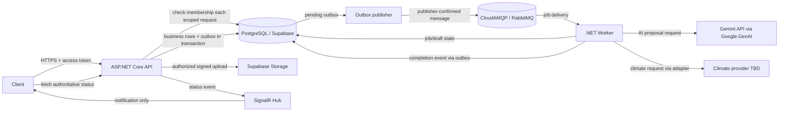

# Phase 1: Farm Planning Pilot - Research

**Researched:** 2026-11-09  
**Domain:** ASP.NET Core backend, PostgreSQL farm operations, asynchronous AI/climate workflows  
**Confidence:** MEDIUM

<user_constraints>
## User Constraints (from CONTEXT.md)

### Locked Decisions
- **D-01:** Use ASP.NET Core Identity for accounts. For every farm-scoped request, validate the user's current active farm membership in the database; do not treat farm-role claims in an access token as sufficient authorization.
- **D-02:** Keep the documented support-mediated recovery flow: a code is sent to the account email, support reviews the request, and an approved user receives a temporary password-change mechanism. Support never sees the user's password. Code lifetime, attempt limits, and session revocation policy remain to be specified during planning.
- **D-03:** The pilot activates owner and farm-administrator workflows. Worker and advisor access remain deferred with their roadmap phases.
- **D-04:** Google AI Studio is the selected Gemini development and key-management environment. The .NET Worker calls the Gemini API through the official `Google.GenAI` C# SDK; the key is a server-side secret and is never sent to a client. Keep model selection configurable.
- **D-05:** The climate-data provider is not selected. Define a climate-provider contract now and choose a source before production; do not fabricate weather data when the provider is unavailable.
- **D-06:** AI outputs are reviewable proposals. A sowing plan or planting-frame choice becomes confirmed farm data only after explicit user approval. Agronomic calculations remain deterministic and use validated parameters.
- **D-07:** The initial crop catalog includes plátano, yuca, batata, arroz, and habichuela.
- **D-08:** When a crop lacks validated agronomic parameters, show the missing fields and withhold unsupported numeric recommendations. Do not invent parameters or present model estimates as validated facts.
- **D-09:** Preserve parameter source and validity metadata so agronomists can validate and update crop rules without changing business logic.
- **D-10:** Treat logbook entries as immutable. A correction is a new operation linked to the entry it corrects, preserving the original and its history.
- **D-11:** Support optional photos for logbook activities using the documented direct-to-Supabase-Storage flow with time-limited authorization issued by the API. Store metadata and references in PostgreSQL; never place binary content in RabbitMQ messages.
- **D-12:** PostgreSQL remains the source of truth. Background work uses the API/Worker, RabbitMQ, an outbox, idempotent processing, and SignalR notifications as specified by the adopted architecture.

### the agent's Discretion
- Choose the bearer-token and refresh-token details that fit ASP.NET Core Identity and the API clients, while keeping farm authorization request-time and server-side.
- Choose the .NET data-access and migration tooling during research and planning, honoring the documented PostgreSQL schemas and cross-farm integrity rules.
- Define bounded timeouts, retry limits, and error mapping for Gemini and climate integrations; retain a visible pending/failed state and never turn external service failure into a confirmed farm record.

### Deferred Ideas (OUT OF SCOPE)
- Worker invitations, task assignment, offline synchronization, advisors, costs, crop safety and withholding periods, extended reporting, and expanded AI features belong to later Gestión phases.
- Marketplace, buyer/seller transactions, traceability, transport, equipment rental, and client UI work are outside this pilot phase.
</user_constraints>

<phase_requirements>
## Phase Requirements

| ID | Description | Research Support |
|----|-------------|------------------|
| REQ-pilot-accounts | Creación y gestión de cuentas de usuario. | Identity configuration, supported recovery controls, token choice and credential handling. |
| REQ-pilot-farms-parcels | Gestión de finca y parcelas. | Request-time membership authorization, relational constraints, PostgreSQL persistence. |
| REQ-pilot-crop-cycle | Selección de cultivo y ciclo. | Crop catalog metadata and missing-input behavior; persistence requirements in project docs. |
| REQ-pilot-sowing-plan | Plan de siembra asistido por IA y revisión climática. | Worker/Gemini adapter, climate provider contract, validated rules, review/approval lifecycle. |
| REQ-pilot-planting-frame | Diseño del marco de cultivo asistido por IA. | Deterministic capacity calculation from validated geometry/rules; AI explains alternatives only. |
| REQ-pilot-manual-logbook | Bitácora con registro manual de actividades. | Append-only correction link; optional signed photo upload flow. |
| REQ-rf-g-01 | Registrar fincas y parcelas con nombre, ubicación, tamaño y cultivo. | Farm-scoped API authorization and relational persistence. |
| REQ-rf-g-05 | Mantener bitácora diaria de siembra, riego, fumigación y cosecha, con fotos opcionales. | Immutable logbook and Supabase Storage upload authorization. |
| REQ-rf-g-10 | Proponer ventana de siembra según cultivo, variedad, zona, fecha deseada, agua, parámetros agronómicos y datos climáticos. Explicar factores, datos faltantes, escenarios, incertidumbre y vigencia. | Climate timestamps/source metadata and AI proposal, with missing-data handling. |
| REQ-rf-g-11 | Calcular capacidad según área útil, pasillos y distancias entre plantas/surcos; comparar marcos validados y explicar densidad, acceso y riego; productor elige. | Deterministic computation and explicit operator confirmation. |
| REQ-rf-g-38 | Proveer catálogo inicial con marco, etapas, duración de ciclo y fechas típicas de siembra, comenzando por cultivos del piloto. | Store source, validation/validity metadata; seed no unvalidated numeric values. |
</phase_requirements>

## Summary

Treat the pilot as a vertical API slice with PostgreSQL as the authority: the API authenticates and authorizes each farm-scoped operation, persists input/job state and an outbox event transactionally, and returns a job identifier. A .NET Worker consumes work through RabbitMQ, calls Gemini through the official `Google.GenAI` SDK where appropriate, and stores only a reviewable draft; explicit user approval is a separate API operation. SignalR reports status changes while clients retrieve durable state from the API. [CITED: `../agro-plan-doc/Doc/AgroPlan - Arquitectura Backend.md`; https://learn.microsoft.com/en-us/aspnet/core/signalr/authn-and-authz?view=aspnetcore-10.0]

Use current supported .NET LTS and align EF Core, its PostgreSQL provider, and tooling on compatible major versions. Microsoft’s lifecycle currently places .NET 10 LTS support through November 2028, while .NET 8 support ends November 2026; the available machine has only SDK 8.0.204, so planning must account for installing/using the .NET 10 SDK. [CITED: https://learn.microsoft.com/en-us/dotnet/core/releases-and-support] [VERIFIED: environment probe `dotnet --list-sdks` -> `8.0.204`]

The phase has unresolved domain inputs: no validated crop parameters were found for the five selected crops. Model output must not fill those gaps with plausible-sounding numbers. The sowing-plan and planting-frame flows should return structured missing-input results until experts provide source-backed values; where facts exist, preserve their source, validation status, and validity dates. [CITED: `.planning/REQUIREMENTS.md` REQ-rf-g-10, REQ-rf-g-11, REQ-rf-g-38; `01-CONTEXT.md` D-07–D-09]

**Primary recommendation:** Implement the API/Worker/outbox flow around explicit, farm-authorized commands and persisted job state; isolate Gemini and climate behind adapters; make deterministic, validated agronomic rules the only source for numeric recommendations.

## Architectural Responsibility Map

| Capability | Primary Tier | Secondary Tier | Rationale |
|------------|-------------|----------------|-----------|
| Account lifecycle and recovery | API / Backend | Database / Storage | Identity owns credential workflows; PostgreSQL stores identity state. |
| Farm, parcel, crop cycle, logbook | API / Backend | Database / Storage | API enforces business and farm-membership rules; PostgreSQL is authoritative. |
| Farm-scoped authorization | API / Backend | Database / Storage | Validate active membership from PostgreSQL on every scoped request. |
| Sowing plan and planting-frame proposals | API / Backend | Worker; external AI | API validates inputs and owns state transitions; Worker calls Gemini asynchronously; numeric domain calculations remain deterministic. |
| Climate review | API / Backend | Worker; external climate API | Adapter normalizes provider data and source/freshness; missing source data is visible. |
| Photo uploads | API / Backend | Supabase Storage | API authorizes and checks membership; binary resides in Storage, references/metadata in PostgreSQL. |
| Job progress | API / Backend | Worker; SignalR | Worker updates durable state; SignalR is a transient notification; client re-queries API. |

## Standard Stack

### Core

| Component | Version | Purpose | Why Standard |
|-----------|---------|---------|--------------|
| .NET / ASP.NET Core | Recommend .NET 10 LTS; runtime target must align | REST API, Identity, hosted Worker, SignalR | Microsoft lifecycle lists .NET 10 LTS through Nov 2028; .NET 8 support ends Nov 2026. [CITED: https://learn.microsoft.com/en-us/dotnet/core/releases-and-support] |
| ASP.NET Core Identity | ASP.NET Core 10 aligned | Accounts, password management, recovery integration | User-locked choice; Identity API bearer tokens are proprietary tokens, not JWT or a full OAuth/OIDC server. [CITED: https://learn.microsoft.com/en-us/aspnet/core/security/authentication/identity-api-authorization?view=aspnetcore-10.0] |
| PostgreSQL / Supabase | Provider-managed; version to confirm | Identity, farm domain, jobs, outbox, audit | Project documents identify PostgreSQL as source of truth. [CITED: `../agro-plan-doc/Doc/AgroPlan - Arquitectura Backend.md`] |
| EF Core + Npgsql | Match provider major to EF Core major | Relational mapping and migrations | Official Microsoft provider list warns providers generally do not work across EF Core major versions; confirm a supported Npgsql EF provider release before pinning. [CITED: https://learn.microsoft.com/en-us/ef/core/providers/] [CITED: https://www.npgsql.org/efcore/index.html] |
| RabbitMQ / CloudAMQP | Managed service; .NET client version to verify | Async jobs and completion events | Project decision; publisher confirms and consumer acknowledgements solve different delivery boundaries. [CITED: https://www.rabbitmq.com/docs/confirms; https://www.rabbitmq.com/client-libraries/dotnet-api-guide] |
| SignalR | ASP.NET Core 10 aligned | Live job-status notification | Notifications are transient; database/API remains authoritative. Connection principal is captured at connect time. [CITED: https://learn.microsoft.com/en-us/aspnet/core/signalr/authn-and-authz?view=aspnetcore-10.0] |
| Gemini API + `Google.GenAI` | Current supported SDK; pin at implementation | AI explanations/drafts in Worker | Google documents official C# GenAI SDK and requires server-side API key handling. Keep model configurable. [CITED: https://ai.google.dev/gemini-api/docs/libraries; https://ai.google.dev/gemini-api/docs/api-key] |
| Supabase Storage | Managed service | Optional logbook photo content | API-issued signed upload authorization supports direct client upload; DB keeps metadata/reference. [CITED: https://supabase.com/docs/guides/storage/uploads/standard-uploads] |

### Supporting

| Component | Purpose | When to Use |
|-----------|---------|-------------|
| `IHostedService` / Worker Service | Outbox publisher and background consumer processes | Use separate API/Worker deployment as the architecture requires. [CITED: https://learn.microsoft.com/en-us/dotnet/core/extensions/workers] |
| Provider adapters (`IGeminiClient`, `IClimateProvider`) | Isolate vendor-specific calls and normalized outputs | Always for external AI/climate integration; user explicitly requires climate contract before source selection. |
| PostgreSQL constraints and transactions | Cross-farm referential integrity and atomic business/outbox writes | Enforce farm ownership in database relationships as defense in depth. [CITED: `../agro-plan-doc/Doc/AgroPlan - Flujos de Datos y Modelo de Datos.md`] |

**Installation:** No package list/version is locked in this research. At planning/implementation, first verify official docs and current provider compatibility, then run the GSD package-legitimacy audit and registry checks for the exact packages before adding them.

## Package Legitimacy Audit

The GSD package-legitimacy command was attempted, but it rejects NuGet (`Usage: ... --ecosystem <npm|pypi|crates>`); do not treat registry presence alone as a legitimacy verdict. For NuGet, rely on official vendor docs and the official NuGet Gallery package pages, then inspect owner/source links and release history before pinning. Google’s official docs identify `Google.GenAI`; the registry showed `Google.GenAI 2.0.0` (updated 2026-11-06), `Npgsql.EntityFrameworkCore.PostgreSQL 10.0.3`, and `RabbitMQ.Client 7.2.2` at research time. These are observed registry versions, not package-legitimacy approvals or a compatibility recommendation. [CITED: https://ai.google.dev/gemini-api/docs/libraries; https://www.nuget.org/packages/Google.GenAI; https://www.nuget.org/packages/Npgsql.EntityFrameworkCore.PostgreSQL; https://www.nuget.org/packages/RabbitMQ.Client]

## Architecture Patterns

### System Architecture Diagram



### Recommended Project Structure

```text
src/
├── AgroPlan.Api/             # HTTP endpoints, Identity, authorization, SignalR
├── AgroPlan.Application/     # use cases, contracts, validation, job state transitions
├── AgroPlan.Domain/          # farm/crop-cycle/logbook rules and immutable corrections
├── AgroPlan.Infrastructure/  # EF Core/Npgsql, migrations, outbox, Storage, RabbitMQ
├── AgroPlan.Worker/          # consumers, Gemini/climate adapters, processing
└── AgroPlan.Contracts/       # versioned API and message contracts, if shared safely
```

This structure is an `[ASSUMED]` greenfield recommendation; validate it against the size of the pilot before creating projects.

### Pattern 1: Transactional outbox with idempotent consumers

**What:** Persist the domain change and pending event in one database transaction; a publisher sends the event and marks it published only after broker confirmation. Consumers acknowledge only after durable processing and use a stable event/job ID to deduplicate. Duplicate sends remain possible if the publisher crashes between broker confirm and database mark. [CITED: `../agro-plan-doc/Doc/AgroPlan - Arquitectura Backend.md`; https://www.rabbitmq.com/docs/confirms]

**When to use:** API job creation and Worker completion events, where database state and message delivery must eventually converge.

### Pattern 2: Farm authorization at command/query boundary

Resolve the current user and active membership from PostgreSQL for every farm-scoped operation; verify resource `farm_id` and membership permission together. Include tenant key in relevant foreign keys/unique constraints so a valid object ID from another farm cannot create a cross-farm relation. `[CITED: 01-CONTEXT.md D-01; ../agro-plan-doc/Doc/AgroPlan - Flujos de Datos y Modelo de Datos.md]`

### Pattern 3: AI outputs as drafts, deterministic rules as authority

Worker input includes only validated farm/crop data needed for a job. Persist normalized structured result, model/provider metadata, input snapshot, prompt/schema version, and missing fields; present it as a draft. Separate explicit confirmation endpoint rechecks current membership and current relevant versions before creating confirmed farm data. Never treat model prose as a numeric agronomic source. `[CITED: 01-CONTEXT.md D-06–D-09; https://ai.google.dev/gemini-api/docs/structured-output]`

### Pattern 4: Direct signed upload

API checks farm membership and creates a pending file metadata record before issuing a time-limited upload authorization. Client uploads directly to Storage, then calls API to finalize; API verifies object/path/size/type against policy before marking it available. Signed upload authorization is time-limited but not individually revocable, so keep expiry short and use unique object paths. [CITED: https://supabase.com/docs/guides/storage/uploads/standard-uploads; `../agro-plan-doc/Doc/AgroPlan - Flujos de Datos y Modelo de Datos.md`]

### Anti-Patterns to Avoid

- Treating Identity API bearer token as a standard JWT/OIDC token. Microsoft describes it as a proprietary token format for simple scenarios. [CITED: https://learn.microsoft.com/en-us/aspnet/core/security/authentication/identity-api-authorization?view=aspnetcore-10.0]
- Embedding farm membership as the only authorization proof in token claims; membership/revocation must be rechecked in PostgreSQL per request.
- Writing database state then publishing directly without outbox; a crash creates missing or duplicate jobs.
- Making SignalR delivery authoritative; reconnecting clients must re-fetch job state from API.
- Letting generated model suggestions silently become confirmed records or fill missing agronomic values.
- Sending Storage binaries or Gemini keys through API responses, logs, or RabbitMQ messages.

## Don't Hand-Roll

| Problem | Don't Build | Use Instead | Why |
|---------|-------------|-------------|-----|
| Authentication/password hashing and reset primitives | Custom password/token system | ASP.NET Core Identity plus reviewed recovery workflow | Security-sensitive lifecycle and lockout/credential behavior. |
| AMQP protocol, confirms, acknowledgements | Custom socket/protocol implementation | Official RabbitMQ .NET client | Protocol and recovery semantics are complex. [CITED: https://www.rabbitmq.com/client-libraries/dotnet-api-guide] |
| Gemini API serialization/auth | Hand-built endpoint wrapper | Official `Google.GenAI` SDK | Officially maintained SDK; secret handling/config remains application responsibility. [CITED: https://ai.google.dev/gemini-api/docs/libraries] |
| File delivery and time-limited authorization | Proxy all photo bytes through API | Supabase Storage signed uploads | Project-approved direct upload flow; API remains authorization gate. [CITED: https://supabase.com/docs/guides/storage/uploads/standard-uploads] |
| Crop-specific agronomic values | Model-generated defaults or guessed constants | Expert-validated catalog with source/validity metadata | Avoid unsupported numeric advice; surface missing validated fields. [CITED: `.planning/REQUIREMENTS.md` REQ-rf-g-38] |

**Key insight:** Separate model-generated explanation from evidence-backed numeric calculation: AI can summarize validated inputs and compare outputs, while deterministic code calculates only when parameter provenance is present.

## Common Pitfalls

### 1. Provider major-version mismatch
**What goes wrong:** EF Core provider fails at runtime or tooling because its major version does not support the selected EF Core major. **Why:** Provider APIs can change across EF majors. **How to avoid:** Select .NET, EF Core, Npgsql provider, and design-time tooling as a tested compatible set; cite the Npgsql support matrix/release note in the plan before pinning. **Warning signs:** restore warnings, missing provider services, migrations failing at startup. [CITED: https://learn.microsoft.com/en-us/ef/core/providers/]

### 2. Stale SignalR authorization
**What goes wrong:** A long-lived connection retains the user principal from connect time after membership changes. **How to avoid:** Authorize group join against current membership, scope events to farm, and define disconnect/revalidation behavior after membership revocation; clients still query API for current state. [CITED: https://learn.microsoft.com/en-us/aspnet/core/signalr/authn-and-authz?view=aspnetcore-10.0]

### 3. False confidence from forecast data
**What goes wrong:** Forecast is treated as guaranteed weather or as agronomic validation. **How to avoid:** Persist provider/model/source, issue time, valid time, location, units and freshness; describe uncertainty and fail visibly when stale/unavailable. Climate API candidate terms disclaim guarantees. [CITED: https://open-meteo.com/en/terms]

### 4. Duplicate async side effects
**What goes wrong:** Retries re-run an AI job or create multiple records. **How to avoid:** Stable job/event IDs, unique idempotency keys, transactional state transitions and consumer deduplication; acknowledge after durable effect. [CITED: https://www.rabbitmq.com/docs/confirms]

### 5. Climate license mismatch
**What goes wrong:** Pilot relies on a non-commercial free tier despite intended commercial operation. **How to avoid:** Choose provider and written license/plan before production; Open-Meteo states its free API is non-commercial and commercial use requires a subscription. [CITED: https://open-meteo.com/en/terms; https://open-meteo.com/en/pricing]

## Climate Provider Candidates (recommendation only)

Provider remains deliberately unselected per D-05. Define a provider-neutral request/response contract now: coordinates, requested period/horizon, normalized units, observed/forecast distinction, source/model, issued-at, valid-time range, data quality/freshness, and explicit unavailable/error response. Compare candidate coverage and licensing before production.

| Candidate | Relevant evidence | Planning view |
|-----------|-------------------|---------------|
| Open-Meteo | Forecast API documents worldwide coverage, with global models for locations outside regional model coverage; hourly/daily variables include precipitation and temperature. Free API is non-commercial; paid plan provides commercial license and dedicated endpoint. [CITED: https://open-meteo.com/en/docs; https://open-meteo.com/en/terms; https://open-meteo.com/en/pricing] | Strong evaluation candidate for Dominican Republic point forecasts, conditional on paid commercial plan, attribution and acceptable model resolution/quality. Do not assume agriculture-specific forecast reliability without validation. |
| OpenWeather 5-day forecast | Official page states any location on globe, 5 days at 3-hour intervals; response exposes temperature, rain accumulation and probability of precipitation. [CITED: https://openweathermap.org/api/forecast5] | Candidate if its forecast horizon and commercial terms meet product needs; inspect actual plan/license and test Dominican coordinates before selection. |

**Recommendation:** Evaluate both against representative Dominican farm coordinates, required sowing decision horizon, precipitation/wind variables, freshness, and total commercial usage cost. Open-Meteo is a reasonable first technical evaluation candidate; this does not select it for production.

## Agronomic Evidence Gaps and Safe Suggestion Boundaries

For all five crops—plátano, yuca, batata, arroz, habichuela—the approved catalog identity is known, but this research found no source-validated values for variety-specific planting windows, spacing, cycle duration/stages, water requirements, or local zone suitability. `[CITED: .planning/REQUIREMENTS.md REQ-rf-g-38; 01-CONTEXT.md D-07–D-09]`

Until an agronomist validates references for each crop/variety and intended Dominican region:

- Permit catalog records to exist with identity and descriptive metadata, but mark numeric parameter fields as missing/unvalidated.
- Do not generate planting dates, plant counts, spacing, yields, fertilizer/pesticide quantities, or crop-cycle durations as authoritative values.
- A sowing proposal may report which required inputs are absent, present known user-entered facts, and explain that no validated recommendation can be calculated; climate may be shown separately with source and timestamp.
- Planting-frame comparisons require validated spacing, area usable for planting, corridor/access, and irrigation assumptions; otherwise return missing-input state and no capacity number.
- AI may explain a comparison that deterministic code computed from validated rules. Do not use model confidence scores as validation status.
- Preserve source URL/document, source date, reviewer/validation status, valid-from/to and units for every parameter; store calculation inputs and rule version with each proposal.

## Code Examples

### ASP.NET Identity API bearer-token caveat

```csharp
// Identity API bearer tokens are a simple proprietary token format,
// not standard JWT. Farm membership must still be checked from PostgreSQL.
builder.Services.AddIdentityApiEndpoints<ApplicationUser>()
    .AddEntityFrameworkStores<ApplicationDbContext>();
```

Source: [Microsoft Identity API authorization](https://learn.microsoft.com/en-us/aspnet/core/security/authentication/identity-api-authorization?view=aspnetcore-10.0). Verify exact setup against selected Identity hosting model before implementation.

### Worker service registration

```csharp
builder.Services.AddHostedService<OutboxPublisher>();
```

Source: [Microsoft Worker Services](https://learn.microsoft.com/en-us/dotnet/core/extensions/workers). Keep hosted background processing deployed as the separate Worker service required by project architecture.

## State of the Art

| Old Approach | Current Approach | Impact |
|--------------|------------------|--------|
| Treating Identity API access token as JWT | Treat built-in Identity bearer token as proprietary, or choose a separately justified standards-based identity design if client requirements demand JWT/OIDC | Client interoperability and validation assumptions must be explicit. [CITED: Microsoft Identity API docs] |
| Publish directly to RabbitMQ after database commit | Transactional outbox + publisher confirms + idempotent consumer | Handles process crash between database and broker operations; duplicates remain expected. [CITED: RabbitMQ confirms; project architecture doc] |
| Treat websocket status as durable state | Persist job state in PostgreSQL; SignalR is notification, client re-fetches API state | Reconnection recovers status and avoids missed-event correctness bugs. [CITED: project architecture doc] |

## Project Constraints (from AGENTS.md)

No `AGENTS.md` exists in the backend working directory; no project-specific directives were found.

## Assumptions Log

| # | Claim | Section | Risk if Wrong |
|---|-------|---------|---------------|
| A1 | A layered API/Application/Domain/Infrastructure/Worker layout is a good fit for the greenfield pilot. | Recommended Project Structure | Could create unnecessary project boundaries for the team's scale. |
| A2 | Open-Meteo is an efficient first candidate for a technical climate comparison. | Climate Provider Candidates | Licensing, forecast skill, support, or operational needs may favor another provider. |
| A3 | The pilot uses first-party REST clients with signed JWT access tokens and opaque rotating refresh tokens. | Resolved Open Questions | Third-party identity federation is outside pilot scope. |
| A4 | Exact current package versions are deferred until planning and need official compatibility/legitimacy verification. | Standard Stack | Could delay project scaffolding if not resolved before implementation. |

## Open Questions — Resolved or Explicitly Gated

1. **Client authentication scope — RESOLVED:** The pilot exposes first-party REST bearer authentication for first-party clients only. Use signed JWT access tokens and opaque rotating refresh tokens; no third-party federation is in scope. Farm authorization remains request-time database membership validation (D-01).
2. **Npgsql EF Core 10 release — RESOLVED AT IMPLEMENTATION GATE:** Do not pin a version based on this research snapshot. Before each package pin, verify official Npgsql release matrix, NuGet publisher/source and release history, and exact EF Core 10 compatibility. Build only after the host has the .NET 10 SDK.
3. **Climate source and commercial plan — EXPLICIT PRODUCTION GATE:** Per D-05, no provider is selected. The pilot implements the provider contract and returns unavailable/missing status; it must not expose live forecast claims. Compare Dominican coverage, horizon, variables, freshness, license/attribution, rate limits and cost using representative locations, and select/validate a source before enabling climate data or production activation.
4. **Support-mediated recovery — RESOLVED:** Codes are random, stored hashed, valid 15 minutes, limited to five attempts, and rate-limited to three requests per account and ten per source IP per hour. Support staff use an authenticated, audited review endpoint; public responses do not disclose account existence. Approval issues a one-time 15-minute password-change token; completion revokes all refresh sessions. Support cannot view or set passwords.
5. **Agronomic source validation — EXPLICIT PRODUCTION GATE:** No agronomist or validated crop-specific numeric sources are selected. Do not seed numeric crop rules or present numeric AI estimates. A qualified agronomist must validate cultivar-, region- and season-specific values with source and validity metadata before numeric advice can be enabled. The pilot may show missing inputs and non-authoritative draft explanations only.
6. **Provider call policy — RESOLVED DEFAULTS:** Gemini calls use 30-second timeout, one retry for transient/rate-limit/server errors with jitter and a configurable circuit breaker opening after five consecutive failures for 30 seconds. A future configured climate adapter uses a 10-second timeout and at most one transient retry. All limits are configuration-backed; provider failure remains visible and drafts remain unconfirmed.
7. **Logbook image handling — RESOLVED / RETENTION GATE:** Accept JPEG, PNG and WebP only, maximum 10 MiB per image, private bucket, one-time upload authorization with 10-minute expiry, and cleanup of unfinalized objects after 24 hours. Finalized attachments follow the immutable entry's retention. Any account-wide retention/deletion policy requiring production-specific legal review must be settled before production activation.

## Environment Availability

| Dependency | Required By | Available | Version | Fallback |
|------------|-------------|-----------|---------|----------|
| .NET SDK | API/Worker build | ✗ | 8.0.204 observed; SDK 10 absent | Install/use .NET SDK 10 before targeting net10.0 or running compile checks; runtime presence is not enough. |
| .NET runtime | Runtime | ✓ | 6.0.x, 8.0.x, 10.0.11 observed | Deploy target runtime/container matching selected target. |
| Docker CLI | Container development/deployment | ✓ | 28.4.0 | None documented; daemon availability was not confirmed. |
| PostgreSQL/Supabase | Persistence | External service required | Not locally probed | Configure non-production Supabase project or local PostgreSQL once execution begins. |
| CloudAMQP/RabbitMQ | Async pipeline | External service required | Not locally probed | Local RabbitMQ container only for development if Docker daemon available. |
| Gemini API key | Worker inference | Secret not probed | — | Mock adapter for local/domain development; no real AI integration without secret. |
| Climate provider/key | Weather review | Provider unselected | — | Contract/mock response in development; must select provider before production. |

**Missing dependencies with no fallback:** None for research/planning; production provider credentials must be provisioned before live integration.

## Validation Architecture

Nyquist validation is enabled by default because `.planning/config.json` is absent. No application source or test infrastructure exists in this greenfield repository. The implementation plan should establish validation commands and Wave 0 scaffolding, but this research task does not add or run tests.

### Test Framework

| Property | Value |
|----------|-------|
| Framework | `[ASSUMED]` .NET test project using xUnit; select/verify package legitimacy during planning. |
| Config file | None detected — create in Wave 0. |
| Quick run command | `[ASSUMED]` `dotnet test --no-restore` after solution and test project exist. |
| Full suite command | Same command initially; split fast unit and integration commands once projects exist. |

### Phase Requirements → Test Map

| Req ID | Behavior | Test Type | Automated Command | File Exists? |
|--------|----------|------------|-------------------|--------------|
| REQ-pilot-accounts | Account lifecycle/recovery without password disclosure | Integration/security | Define in Wave 0 | No |
| REQ-pilot-farms-parcels | Cross-farm access denied, active member allowed | Integration/security | Define in Wave 0 | No |
| REQ-pilot-crop-cycle | Cycle links valid farm parcel and catalog crop | Integration | Define in Wave 0 | No |
| REQ-pilot-sowing-plan, REQ-rf-g-10 | Missing validated inputs do not produce invented numeric advice; draft approval required | Unit + integration | Define in Wave 0 | No |
| REQ-pilot-planting-frame, REQ-rf-g-11 | Capacity uses validated dimensions/rules; no result if inputs missing | Unit + integration | Define in Wave 0 | No |
| REQ-pilot-manual-logbook, REQ-rf-g-05 | Correction is linked append-only record; photo belongs to authorized farm | Integration/security | Define in Wave 0 | No |
| REQ-rf-g-01 | Farm/parcel attributes persist and are isolated by farm | Integration | Define in Wave 0 | No |
| REQ-rf-g-38 | Catalog provenance and validation state retained for all five crop entries | Unit + integration | Define in Wave 0 | No |

### Wave 0 Gaps

- [ ] Create solution/projects and test project; choose framework/package after legitimacy check.
- [ ] Add integration environment strategy for PostgreSQL and RabbitMQ.
- [ ] Add authorization fixtures for multiple farms and revoked membership.
- [ ] Add deterministic agronomy fixtures only from approved sources; tests should assert missing-input paths before any such seed is approved.

## Security Domain

### Applicable ASVS Categories

| ASVS Category | Applies | Standard Control |
|---------------|---------|-----------------|
| V2 Authentication | Yes | ASP.NET Core Identity; rate-limited recovery codes; no support access to passwords. |
| V3 Session Management | Yes | Explicit access/refresh lifetime, rotation/revocation policy; revalidate long-lived SignalR connections after membership changes. |
| V4 Access Control | Yes | Request-time active membership check; enforce farm ownership on queries, mutations, uploads, jobs, and hub group subscriptions. |
| V5 Input Validation | Yes | Server-side DTO validation; coordinate/unit/date bounds; validate upload type/size and normalized provider output. |
| V6 Cryptography | Yes | Use platform Identity cryptography and TLS; never implement password hashing or token crypto. |

### Known Threat Patterns

| Pattern | STRIDE | Standard Mitigation |
|---------|--------|---------------------|
| Insecure direct object reference across farms | Elevation of privilege | Resolve resource farm and current active membership in one authorized query; enforce composite FK/unique constraints. |
| Stolen/overlong bearer or recovery token | Spoofing | Short-lived credentials, refresh rotation/revocation policy, rate limits, one-time recovery token, secure storage. |
| Cross-farm SignalR group join | Elevation of privilege / Information disclosure | Authorize join against current membership; do not trust a client-supplied farm ID. |
| Forged/oversized upload or leaked signed URL | Tampering / Information disclosure | Short expiry, unique opaque object path, pending metadata, finalize verification, private bucket, avoid sensitive content in URL/logs. |
| Prompt injection or fabricated model output | Tampering | Treat provider output as untrusted; schema-validate, constrain use to proposal text, deterministic rules for values, human confirmation. |
| Broker duplicate/replay message | Tampering / Denial of service | Stable IDs, idempotent state transitions, authenticated TLS connection, least-privilege credentials and bounded retry/dead-letter policy. |

## Sources

### Primary

- Microsoft .NET support policy — lifecycle dates for supported .NET versions. https://learn.microsoft.com/en-us/dotnet/core/releases-and-support
- Microsoft EF Core providers — provider/version compatibility cautions. https://learn.microsoft.com/en-us/ef/core/providers/
- Microsoft Identity API authorization — built-in token characteristics. https://learn.microsoft.com/en-us/aspnet/core/security/authentication/identity-api-authorization?view=aspnetcore-10.0
- Microsoft SignalR authentication — connection principal behavior. https://learn.microsoft.com/en-us/aspnet/core/signalr/authn-and-authz?view=aspnetcore-10.0
- Microsoft Worker Services — hosted service pattern. https://learn.microsoft.com/en-us/dotnet/core/extensions/workers
- Google Gemini libraries and API key handling. https://ai.google.dev/gemini-api/docs/libraries ; https://ai.google.dev/gemini-api/docs/api-key
- Supabase Storage upload documentation. https://supabase.com/docs/guides/storage/uploads/standard-uploads
- RabbitMQ .NET API and publisher confirms. https://www.rabbitmq.com/client-libraries/dotnet-api-guide ; https://www.rabbitmq.com/docs/confirms
- Open-Meteo API, terms, and pricing. https://open-meteo.com/en/docs ; https://open-meteo.com/en/terms ; https://open-meteo.com/en/pricing
- OpenWeather 5-day forecast. https://openweathermap.org/api/forecast5
- Project docs: `.planning/REQUIREMENTS.md`, `01-CONTEXT.md`, `../agro-plan-doc/Doc/AgroPlan - Arquitectura Backend.md`, `../agro-plan-doc/Doc/AgroPlan - Flujos de Datos y Modelo de Datos.md`.

## Metadata

**Confidence breakdown:**
- Standard stack: MEDIUM — selected technologies are documented in project context; exact EF/Npgsql and SDK package versions must be checked at implementation.
- Architecture: MEDIUM — aligned with project architecture docs and official framework/messaging behavior.
- Pitfalls: MEDIUM — strongest for token semantics, SignalR connection identity, broker confirms, and climate terms; agronomic facts are intentionally unresolved.

**Research date:** 2026-11-09  
**Valid until:** 2026-12-09 for stable architecture; recheck SDK/provider versions and climate terms immediately before implementation/production.
