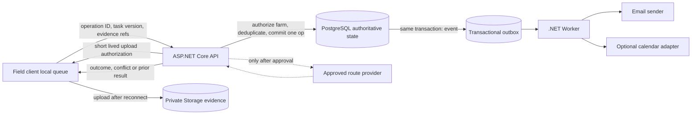

# Phase 3: Workforce and Offline Operations - Research

**Researched:** 2026-11-10
**Domain:** ASP.NET Core/.NET 10, EF Core/PostgreSQL, secure workforce workflows, offline synchronization
**Confidence:** HIGH for existing stack and EF/PostgreSQL patterns; MEDIUM for provider-neutral route/calendar boundaries

<user_constraints>
## User Constraints (from CONTEXT.md)

### Locked Decisions
### Worker invitations and farm access
- **D-01:** Workers join through a single-use email link. Pending invitations expire after seven days, can be renewed or cancelled by a farm administrator, and count against the basic-plan limit of five workers.
- **D-02:** Preserve per-request farm authorization and re-read current membership from PostgreSQL so revoked access takes effect immediately. Worker access is limited to assigned work and permitted history; do not expose farm financial records.

### Tasks, evidence, verification, and wages
- **D-03:** Photo evidence is required per task according to its configured rule. Location and time collection are optional and require worker consent.
- **D-04:** A requested correction creates a new linked submission revision; keep the prior submission and evidence intact.
- **D-05:** The administrator sets wage amount and unit at task assignment. The amount is confirmed only after the task is verified. AgroPlan records wages but does not execute payments.

### Offline synchronization and conflicts
- **D-06:** Each offline operation carries a stable client-generated unique ID reused on retries for idempotency.
- **D-07:** Return a result for each operation in a sync batch. Continue independent operations when one fails and identify retryable failures.
- **D-08:** Preserve both task versions when a stale client update conflicts with server state. A farm administrator explicitly resolves the conflict; never silently overwrite either version.

### Points, badges, rankings, and rewards
- **D-09:** Extra points use objective criteria configured per task; do not automatically score photo quality.
- **D-10:** Rankings are disabled by default and can be enabled by a farm administrator.
- **D-11:** Badges use configured rules. Rewards are manually granted by the administrator; no payment processing is included.

### Routes and offline route data
- **D-12:** Define a provider-neutral geographic/routing contract. Keep route generation unavailable until a provider is selected and approved.
- **D-13:** Offline route data includes ordered task stops and available route geometry, without offline base maps or turn-by-turn navigation.
- **D-14:** If assigned tasks or parcels change after confirmation, mark the route stale. The administrator reviews and confirms a new route version.

### Calendar updates and partial failures
- **D-15:** A scheduling change creates a new version, retains the previous assignment in audit history, and notifies the worker.
- **D-16:** If an external calendar update fails after AgroPlan saves the task, keep the task, expose synchronization as pending, and retry it.
- **D-17:** Batch processing isolates failures, returns per-operation outcomes, and continues independent work.

### the agent's Discretion
- Choose entity boundaries, endpoint grouping, sync response codes, retention policy details, and notification mechanisms consistent with existing API/outbox patterns and the decisions above.
- Define explicit limits and validation for invitation tokens and evidence uploads from existing security and storage constraints.
- Propose the geographic-provider selection gate and operational criteria; do not activate a provider without approval.

### Deferred Ideas (OUT OF SCOPE)
None — discussion stayed within Phase 3 scope.
</user_constraints>

<phase_requirements>
## Phase Requirements

| ID | Description | Research Support |
|----|-------------|------------------|
| REQ-rf-g-06 | Manage up to five workers in base functions, linked to a farm. | Serialize plan-capacity reservation in PostgreSQL; count active workers and unexpired pending invites within the same transaction. |
| REQ-rf-g-09 | Expose pending/synchronized status; retries do not duplicate effects. | Persist operation ID, payload fingerprint, outcome, and domain effect atomically; enforce a unique database key. |
| REQ-rf-g-12 | Propose efficient work routes, reviewed/confirmed by admin; geographic provider/motor TBD. | Provider-neutral route interface with explicit unavailable state; approval is an external gate. |
| REQ-rf-g-14 | Unlimited workers on premium plan, associated with configured service level. | Resolve plan entitlement server-side; do not trust client-supplied plan or count. |
| REQ-rf-g-17 | Link worker account to a farm by creation or invitation. | Single-use invite acceptance transaction creates membership and marks invite consumed. |
| REQ-rf-g-18 | Show worker today's tasks with workflow state; only own/assigned tasks. | Farm and assignee filtering in every query and mutation; administrator-only verification transition. |
| REQ-rf-g-19 | Provide recommended field routes available offline. | Store ordered stops and portable geometry in a versioned confirmed route snapshot. |
| REQ-rf-g-20 | Attach photos and optional consented location/time; upload after reconnect. | Private object storage, authorized staging upload, immutable evidence submission revisions. |
| REQ-rf-g-21 | Admin approves, rejects with reason, or requests correction; only verified work accrues wage/evidence level. | Explicit review transitions and append-only decisions; create wage/reward ledger effects once on verification. |
| REQ-rf-g-22 | Worker sees own task/evidence/verified-wage history; data private except farm admin. | Resource authorization and farm/worker-scoped history projections. |
| REQ-rf-g-23 | Operate offline; retain evidence locally; sync idempotently after reconnect. | Client operation key, atomic DB idempotency record, per-op response and conflict persistence. |
| REQ-rf-g-25 | Points for verified completed tasks; extras for complete/clear evidence; no speed-only points. | Versioned objective per-task criteria and unique points ledger entries sourced from verification. |
| REQ-rf-g-26 | Streaks derived from consecutive days with verified tasks. | Derive or update idempotently from verified-task ledger/date in the farm timezone. |
| REQ-rf-g-27 | Levels/badges based on configured criteria. | Activate only explicitly configured deterministic rules; never infer photo quality. |
| REQ-rf-g-28 | Farm team goals with collective progress toward an explicit target. | Compute progress from verified work and an explicit target; scope data to the farm. |
| REQ-rf-g-29 | Admin-defined rewards; AgroPlan does not pay money. | Record reward grants and audit actor/time; no payment integration. |
| REQ-rf-g-30 | Worker progress board; ranking optional and admin-enabled. | Farm setting defaults ranking off; authorize aggregate visibility according to that setting. |
| REQ-rf-g-41 | Confirmed records affect pending tasks/calendars; explain proposals; admin confirms date changes. | Create an auditable schedule version and outbox effects from the same transaction as task changes. |
</phase_requirements>

## Summary

Build the phase on the existing backend rather than adding another sync, task, or messaging framework. PostgreSQL should own task state, invitations, evidence metadata, conflict records, synchronization receipts, reward/wage ledger entries, and schedule versions. Give each offline operation its own transaction and durable idempotency receipt; a retry returns its recorded result, while a changed payload reusing the same operation ID is rejected. A stale task version should be saved as a conflict alongside the server version for explicit administrator resolution. PostgreSQL's unique-index arbitration is concurrency-safe [CITED: PostgreSQL INSERT / ON CONFLICT]; EF Core's configured concurrency token can surface stale writes [CITED: EF Core concurrency handling].

Use ASP.NET Core Identity and the existing email sender for invitation delivery, but keep farm invitations separate from account email confirmation [CITED: ASP.NET Core Identity API authorization; VERIFIED: `src/AgroPlan.Application/Abstractions/IEmailSender.cs:3-6`]. To enforce the user's single-use rule, generate an opaque cryptographic token, persist only its digest and expiry/consumption state, and atomically consume it while creating/activating the farm membership [CITED: OWASP Forgot Password Cheat Sheet; ASSUMED: persisted invite digest lifecycle is the selected implementation]. Reserve a basic-tier slot in a database transaction to avoid concurrent invitation races [CITED: PostgreSQL INSERT / ON CONFLICT]. Keep worker authorization resource-scoped and revalidated against current farm membership on each request [VERIFIED: `src/AgroPlan.Infrastructure/Persistence/FarmAuthorizationService.cs:7-14`].

Reuse the transactional outbox and Worker for invitation delivery, worker notifications, and retryable calendar effects; do not send messages or contact provider APIs inside a database transaction [VERIFIED: `src/AgroPlan.Infrastructure/Messaging/OutboxPublisher.cs`; CITED: ASP.NET Core hosted services]. Treat route generation as unavailable until a provider is approved [user-locked D-12]. A portable geometry representation such as GeoJSON can be used as the provider-neutral interchange format, but GeoJSON is not a route optimizer [CITED: RFC 7946].

**Primary recommendation:** Use current application/domain services plus PostgreSQL constraints/transactions and existing outbox; add no new NuGet packages until a concrete capability gap is demonstrated.

## Architectural Responsibility Map

| Capability | Primary Tier | Secondary Tier | Rationale |
|------------|-------------|----------------|-----------|
| Invite issue/acceptance and worker authorization | API / Backend | Database | The API authenticates actors and checks live farm membership [VERIFIED: `src/AgroPlan.Infrastructure/Persistence/FarmAuthorizationService.cs:7-14`]; PostgreSQL atomically enforces token use and member limits [CITED: PostgreSQL INSERT / ON CONFLICT]. |
| Tasks, review, evidence metadata, wages/rewards | API / Backend | Database / Storage | Domain transitions and permissions are server-owned; PostgreSQL holds authoritative history and private object storage holds binary evidence. |
| Offline queue and local evidence retention | Browser / Client | API / Backend | Client must retain work while disconnected; backend validates and deduplicates operations after reconnect. Client repository owns local UI/storage. |
| Idempotent sync/conflict resolution | API / Backend | Database | API validates and returns operation outcomes; PostgreSQL unique constraints and transactions protect concurrency across API instances. |
| Notification and calendar side effects | Worker | API / Database | API commits state and outbox messages; Worker retries external effects without rolling back confirmed task state [VERIFIED: `src/AgroPlan.Infrastructure/Messaging/OutboxPublisher.cs`; CITED: ASP.NET Core hosted services]. |
| Route planning | API / Backend | External provider | API owns provider-neutral contract and approval/versioning; provider remains unselected, so route generation is safely unavailable. |
| Points, streaks, badges, goals | API / Backend | Database | Only verified task transitions award immutable ledger effects; database uniqueness guards duplicate award events. |

## Standard Stack

### Core

| Library | Version | Purpose | Why Standard |
|---------|---------|---------|--------------|
| .NET / ASP.NET Core | `net10.0` target | API and Worker services | Already selected and used by all project layers [VERIFIED: `src/AgroPlan.IntegrationTests/AgroPlan.IntegrationTests.csproj:3`, quote: `<TargetFramework>net10.0</TargetFramework>`]. |
| EF Core + Npgsql provider | `Npgsql.EntityFrameworkCore.PostgreSQL` `10.0.3` | PostgreSQL persistence, migrations, concurrency handling | Existing project dependency [VERIFIED: `src/AgroPlan.Infrastructure/AgroPlan.Infrastructure.csproj:8`, quote: `<PackageReference Include="Npgsql.EntityFrameworkCore.PostgreSQL" Version="10.0.3" />`]. |
| ASP.NET Core Identity | `10.0.0` | Account identity and email workflow primitives | Existing dependency [VERIFIED: `src/AgroPlan.Infrastructure/AgroPlan.Infrastructure.csproj:7`, quote: `<PackageReference Include="Microsoft.AspNetCore.Identity.EntityFrameworkCore" Version="10.0.0" />`]. |
| PostgreSQL | Supabase-managed; server version configuration TBD | Authoritative transactions, unique constraints, outbox, operation receipts | Existing project system-of-record [CITED: `.planning/PROJECT.md`]; use database guarantees rather than process-local locks [CITED: PostgreSQL INSERT / ON CONFLICT]. |
| RabbitMQ + existing outbox | `RabbitMQ.Client` `7.2.2` | Durable, retryable external notifications/effects | Existing package [VERIFIED: `src/AgroPlan.Infrastructure/AgroPlan.Infrastructure.csproj:10`, quote: `<PackageReference Include="RabbitMQ.Client" Version="7.2.2" />`]. Publisher claims pending rows with `FOR UPDATE SKIP LOCKED` and retries delivery [VERIFIED: `src/AgroPlan.Infrastructure/Messaging/OutboxPublisher.cs`]. |
| Supabase Storage via S3 API | `AWSSDK.S3` `4.0.104.11` | Private task evidence blobs | Existing package [VERIFIED: `src/AgroPlan.Infrastructure/AgroPlan.Infrastructure.csproj:11`, quote: `<PackageReference Include="AWSSDK.S3" Version="4.0.104.11" />`]; storage adapter issues presigned URLs and finalizes staged uploads [VERIFIED: `src/AgroPlan.Infrastructure/Storage/SupabaseFileStorage.cs`]. |

### Supporting

| Library | Version | Purpose | When to Use |
|---------|---------|---------|-------------|
| ASP.NET Core Identity token/email APIs | Framework-provided | Account confirmation and email integration | Use for identity-specific workflows. For farm invitation acceptance, persist a dedicated one-time token digest and consumed state so farm-membership acceptance is explicitly one-use and revocable. |
| ASP.NET Core Rate Limiting middleware | Shared ASP.NET Core framework | Per-instance abuse throttle for invite/resend/accept endpoints | Add endpoint policies if needed, but do not treat in-memory middleware counters as a cluster-wide invite quota; use database constraints and shared edge protection for global limits. |
| GeoJSON, RFC 7946 | Format standard; no library required yet | Provider-neutral stop/geometry transfer | Use only if route geometry is supplied by an approved provider. It defines interoperable geographic JSON, not route optimization or base maps. |

**Installation:** None recommended for this phase from research. Extend the existing solution and dependencies first.

## Architecture Patterns

### System Architecture Diagram



### Recommended Project Structure

```text
src/
├── AgroPlan.Domain/          # Worker, invitation, task, submission, conflict and ledger invariants
├── AgroPlan.Application/     # Use cases, authorization ports, routing/calendar abstractions
├── AgroPlan.Infrastructure/  # EF configurations, migrations, storage, email and external adapters
├── AgroPlan.Api/             # Farm-scoped endpoints and per-request authorization
├── AgroPlan.Worker/          # Outbox delivery and retryable external side effects
├── AgroPlan.UnitTests/       # State transition/idempotency rules
└── AgroPlan.IntegrationTests/# PostgreSQL, API authorization, outbox and concurrency behavior
```

### Pattern 1: Single-use farm invite with capacity reservation

**What:** Store an invitation record scoped to a farm, invitee email, role, expiry, issuer, token digest, and consumption/cancellation state. Send the raw opaque token only in the one-time email link. Acceptance validates token digest, expiry, account email ownership/verification, farm invitation status, and live admin authority; in one DB transaction it consumes the invitation and creates/activates membership. Reserve a worker seat while creating the invitation, serializing concurrent requests for the same farm (for example, lock the farm row or use a dedicated entitlement counter). Renew by superseding the old token/record; never reactivate a consumed token.

**When to use:** Invitation issuance, renew/cancel, and acceptance.

**Security notes:** OWASP guidance for emailed account tokens calls for cryptographic randomness, secure storage, single use, expiry, and rate limiting [CITED: [OWASP Forgot Password Cheat Sheet](https://cheatsheetseries.owasp.org/cheatsheets/Forgot_Password_Cheat_Sheet.html)]. Apply that to worker invitations [ASSUMED: analogous application of OWASP email recovery token guidance]. ASP.NET Identity's email-confirmation token is not itself a farm membership transaction; do not equate account email confirmation with invite acceptance [CITED: [ASP.NET Core Identity API authorization](https://learn.microsoft.com/en-us/aspnet/core/security/authentication/identity-api-authorization?view=aspnetcore-10.0)]. Apply endpoint throttles and avoid account/farm enumeration in public acceptance responses [CITED: OWASP Forgot Password Cheat Sheet].

### Pattern 2: Each sync operation commits independently and is idempotent

**What:** For every client operation ID, insert an operation receipt with a unique key and request fingerprint. In the same transaction as its task/evidence effect, persist the terminal result and outbox events. If the key already exists and the fingerprint matches, return its saved result; if the fingerprint differs, reject the reused key. Process each batch member in a separate transaction/context so one validation, authorization, or concurrency error cannot abort independent work. Distinguish accepted/replayed, conflict needing human resolution, retryable infrastructure failure, and permanent validation failure. Do not commit a success receipt before the domain effect or vice versa.

**When to use:** Offline mutation batches and evidence metadata registration.

**Why:** PostgreSQL `ON CONFLICT` and unique index arbitration provide concurrency-safe insert behavior across multiple API instances [CITED: [PostgreSQL INSERT / ON CONFLICT](https://www.postgresql.org/docs/current/sql-insert.html)]. EF `DbContext` must not be used concurrently for parallel operations; use independent scopes/contexts if parallel processing is introduced [CITED: [DbContext.SaveChanges documentation](https://learn.microsoft.com/en-us/dotnet/api/microsoft.entityframeworkcore.dbcontext.savechanges?view=efcore-10.0)]. Do not rely on an in-memory idempotency dictionary [ASSUMED: architecture recommendation derived from durable multi-instance requirements].

### Pattern 3: Stale version is preserved, then resolved explicitly

**What:** Client mutation carries the version it last read. Store a version field as an EF concurrency token, detect the stale write, and append a conflict record containing task ID, client operation ID, base version, attempted client values, current server version, and actor/time. Keep the authoritative server task untouched until administrator resolution creates a new version referencing the conflict and chosen values. Make conflict creation and its operation receipt atomic; retries return the same conflict identifier/outcome.

**When to use:** A disconnected worker submits a task update after the server task changed.

**Why:** EF Core documents optimistic concurrency using a configured token and reports conflicting writes via `DbUpdateConcurrencyException`; its guidance allows application-specific merge logic [CITED: [EF Core concurrency handling](https://learn.microsoft.com/en-us/ef/core/saving/concurrency)]. Here the user's locked choice requires preserving both versions and explicit resolution, so automatic merge/retry is prohibited [user-locked D-08]. A matching repository analog is `SowingProposalConfiguration`: `src/AgroPlan.Infrastructure/Persistence/Configurations/SowingProposalConfiguration.cs:23` quotes `builder.Property(proposal => proposal.StatusVersion).IsConcurrencyToken();` [VERIFIED].

### Pattern 4: Confirm domain state and outbox together; retry external effects

**What:** Save task/schedule/reward state, audit/version data, and relevant outbox records in a single PostgreSQL transaction. Worker sends email/SignalR/calendar adapter requests after commit. Persist attempts and next-attempt time, use idempotent effect identifiers, expose pending/final failure state, and avoid rolling back the source-of-truth task when an external connector is down [VERIFIED: `src/AgroPlan.Infrastructure/Messaging/OutboxPublisher.cs`; CITED: [ASP.NET Core hosted services](https://learn.microsoft.com/en-us/aspnet/core/fundamentals/host/hosted-services?view=aspnetcore-10.0)].

**When to use:** Invitation delivery, task assignment/review notifications, schedule updates, and optional calendar connectors.

**Why:** ASP.NET Core hosted services can create DI scopes to consume scoped services. The repository's `OutboxPublisher` already creates scopes, claims rows with `FOR UPDATE SKIP LOCKED`, and schedules bounded retries. Never make a third-party calendar provider a prerequisite to saving an AgroPlan task.

### Pattern 5: Separate immutable evidence revisions from task state

**What:** Model task assignment/schedule, worker submission, attachment references, administrator decision, and correction-request revision as separate records linked by stable identifiers. A photo-required task may be submitted only after authorized evidence references are finalized. Preserve prior submitted evidence and review decisions. Location/time values are accepted only when consent is recorded and should not be silently added by infrastructure [user-locked D-03, D-04].

**When to use:** Complete task, request correction, resubmit, approve/reject, and worker history.

**Security:** Every task, submission, and attachment read/download must validate farm membership and either assigned worker ownership or administrator role, then bind the object key to that authorized submission. Do not expose financial farm projections to workers.

## Don't Hand-Roll

| Problem | Don't Build | Use Instead | Why |
|---------|-------------|-------------|-----|
| Cryptographic invitation token generation | Predictable IDs, raw email+farm IDs, timestamps, or custom PRNG | .NET cryptographic random generator plus persisted token digest/expiry/consumption | Guessable invitations allow unauthorized account-to-farm membership. |
| Idempotency under multiple API instances | Static dictionary or process mutex | PostgreSQL unique constraint and transaction-backed operation receipt | Process memory is not shared, durable, or restart-safe. |
| Optimistic conflict detection | Compare timestamps only or last-write-wins | EF Core concurrency token plus an explicit persisted conflict record | Timestamp precision/clock skew can miss writes and overwrite user work. |
| Durable email/calendar retries | Send during request and assume success | Existing transactional outbox and Worker | Process/network failure between DB commit and external request loses or duplicates effects. |
| Route optimizer or map stack before decision | Custom geographic route algorithm or vendor SDK now | Provider-neutral adapter contract with feature unavailable until approval | Provider and motor are explicitly unselected; algorithm/data license, offline coverage, and costs remain unvalidated. |
| Photo evidence storage | Store image bytes in PostgreSQL or public bucket URLs | Existing private Supabase/S3-compatible staged upload and metadata records | Blob storage already exists; private access and staging/finalization patterns are in place. |

**Key insight:** The hard part is preserving exactly-once *effects* over at-least-once network retries. A database receipt and business mutation must commit atomically; messaging and external calendar calls then remain retryable and idempotent.

## Common Pitfalls

### Pitfall 1: Counting worker seats with a race
**What goes wrong:** Two administrators each see four active/pending workers and create an invitation, exceeding the base cap.
**Why it happens:** A read-then-insert count without shared serialization is not an invariant under concurrent requests.
**How to avoid:** Reserve a seat in the same PostgreSQL transaction under a farm-scoped row lock or serialized capacity record; count active workers plus non-expired pending invites and release seats on expiry/cancel. Premium unlimited is a server-side entitlement.
**Warning signs:** Capacity is checked only in API memory or tests never race invite creation.

### Pitfall 2: Treating account confirmation as invitation acceptance
**What goes wrong:** A worker confirms their email but the invitation remains reusable, or a different account can claim the invitation.
**Why it happens:** Email confirmation proves an account's address; it does not by itself authorize a specific farm membership.
**How to avoid:** Bind invite to normalized verified email (or an explicitly approved identity flow), consume invite and activate membership atomically, and test second-use, expired, cancelled, renewed, and wrong-account cases.
**Warning signs:** The confirmation handler directly adds membership without checking invitation state.

### Pitfall 3: Idempotency receipt and domain write are separate commits
**What goes wrong:** A crash after storing an operation ID but before creating task/evidence returns an empty success on retry, or a crash after creating the effect duplicates it.
**Why it happens:** The operation receipt and domain mutation are treated as separate steps.
**How to avoid:** Commit the unique operation receipt, effect, response, and outbox event in one transaction. Persist fingerprint; reject key reuse with a different payload.
**Warning signs:** A retry handler returns `already processed` without recovering the original response or checking the payload.

### Pitfall 4: Concurrent operations share a DbContext
**What goes wrong:** Parallel operations corrupt EF state or throw threading errors, defeating per-op isolation.
**Why it happens:** `DbContext` isn't thread-safe and EF doesn't support parallel operations on one instance.
**How to avoid:** Start with sequential operations per batch or create an independent DI scope/DbContext per operation; bound concurrency only after measurement.
**Warning signs:** `Task.WhenAll` wraps service methods receiving a request-scoped context.

### Pitfall 5: Conflict is reported but the losing version disappears
**What goes wrong:** Server rejects a stale task write but does not persist client attempted values, so the user cannot compare or resolve it later.
**Why it happens:** Concurrency exception is mapped to HTTP 409 only, with no conflict record.
**How to avoid:** Store base version, attempted values/evidence references, current server snapshot, and resolution audit. Return stable conflict identity on retry.
**Warning signs:** The API gives a conflict status but a subsequent refresh has no copy of the attempted work.

### Pitfall 6: Awarding points or wages more than once
**What goes wrong:** Retried approval duplicates wage confirmation, points, streak progress, or badge events.
**Why it happens:** Derived effects are generated on each approval request or notification delivery.
**How to avoid:** Make verification a versioned transition and place unique source event IDs on ledger entries; calculate/rebuild aggregate projections from verified events.
**Warning signs:** Retry approval produces extra ledger rows.

### Pitfall 7: Calendar state blocks task state
**What goes wrong:** Task assignment fails because a calendar/notification connector is unavailable, or task is saved with no visible pending update.
**Why it happens:** External I/O happens inside the request transaction or delivery status isn't modeled.
**How to avoid:** Commit task/schedule and outbox atomically; expose `pending/failed/retried` delivery state and retry independently. Since no provider is approved, don't activate external sync until approval.
**Warning signs:** API waits for remote calendar response before returning the authoritative task.

### Pitfall 8: Evidence upload URL becomes access control
**What goes wrong:** Guessable or leaked file keys allow users outside the farm to read worker evidence.
**Why it happens:** Signed URL or client-supplied object key is treated as sufficient authorization.
**How to avoid:** Authorize every issue/finalize/download action against the current farm membership, task assignment, and submission owner; scope keys by farm and submission; keep objects private and URL expiry short.
**Warning signs:** Download endpoint accepts a raw bucket key without loading its associated task and farm.

## Code Examples

### EF optimistic token already used by the project

```csharp
builder.Property(proposal => proposal.StatusVersion).IsConcurrencyToken();
```

Source: [verified repository configuration](../../src/AgroPlan.Infrastructure/Persistence/Configurations/SowingProposalConfiguration.cs#L23). This is a concrete local pattern, not the full task conflict implementation.

### PostgreSQL idempotency insert shape

```sql
INSERT INTO sync_operation_receipts (farm_id, actor_user_id, operation_id, payload_hash)
VALUES (@farm_id, @actor_id, @operation_id, @payload_hash)
ON CONFLICT (farm_id, actor_user_id, operation_id) DO NOTHING;
```

Treat this as a pattern sketch, not an existing schema. Read the receipt after conflict and compare request fingerprint before replaying stored outcome. PostgreSQL docs guarantee `ON CONFLICT DO UPDATE` atomic insert-or-update arbitration under concurrency; `DO NOTHING` is suitable for detecting an already-owned key, with the follow-up read performed under an appropriate transaction/isolation strategy.

## State of the Art

| Old Approach | Current Approach | When Changed | Impact |
|--------------|------------------|--------------|--------|
| Last write wins for offline edits | Versioned optimistic concurrency and explicit conflict resolution | EF Core documents concurrency token support; current conflict behavior is application-defined | The app must persist and surface both versions; a concurrency exception alone is insufficient. |
| Send external email/calendar updates before or inside database commit | Transactional outbox + retryable worker | Existing project architecture and hosted-service model | Domain state survives external outages, with visible delivery state. |
| Client-only deduplication | Server-side persistent operation receipts with unique keys | PostgreSQL unique constraints/`ON CONFLICT` | Retries remain safe across restarts and API replicas. |
| Vendor-specific route response as stored domain model | Provider-neutral route snapshot and geometry interchange | Phase decision D-12; RFC 7946 offers portable GeoJSON geometry | Provider changes don't alter confirmed task assignment contract; optimizer remains replaceable. |

**Deprecated/outdated:** None identified for the selected stack. No new routing or calendar vendor was selected.

## Assumptions Log

| # | Claim | Section | Risk if Wrong |
|---|-------|---------|---------------|
| A1 | A single use invitation token should be persisted independently of Identity email-confirmation tokens so it can be cancelled/renewed and consumed in the membership transaction. | Architecture Patterns | If the product requires invitation acceptance to be exactly account email confirmation, identity integration may need a combined flow; membership still needs atomic authorization. |
| A2 | Base worker cap counts active workers and current pending invitations; expired/cancelled invitations release capacity. | Phase requirements | Billing policy may define the cap differently; this affects seat reservation tests and plan enforcement. |
| A3 | A local GeoJSON route snapshot is an acceptable provider-neutral transfer shape if the approved provider returns geometry. | Standard Stack | The eventual provider or client may need an alternate format; keep adapters responsible for conversion. |
| A4 | “External calendar” in D-16 refers to an optional connector whose provider is not yet chosen; internal calendar/task state remains authoritative and must still update. | Architecture Patterns | If a specific external calendar integration is actually mandatory in Phase 3, provider selection and credentials become a new planning gate. |
| A5 | The client persists offline queues and blobs; this backend phase implements authenticated receipt, idempotency, conflict, and storage APIs, not client offline UI. | Architectural Responsibility Map | If the client repository is not ready, end-to-end offline acceptance cannot be completed solely in this backend repository. |

## Open Questions

1. **What calendar provider, if any, is meant by “external calendar”?**
   - What we know: AgroPlan remains the authoritative task/calendar store and the user selected a pending/retry status when an external update fails.
   - What's unclear: No provider, connector protocol, credentials, or required external behavior is selected in context or roadmap.
   - Recommendation: Plan an internal versioned schedule plus provider-neutral outbox port; leave connector disabled and document the production activation gate until provider selection.
2. **What exactly counts as a worker for capacity?**
   - What we know: Pending invitations count; base cap is five; premium allows unlimited workers.
   - What's unclear: Existing farm admins/owners, disabled accounts, multiple farms, and reinvitations may or may not consume a worker seat.
   - Recommendation: Lock definitions in plan as active Worker memberships plus current Pending Worker invitations, excluding farm administrators/owners; expire/cancel releases invite reservation. Confirm the active-worker counting rule before entitlement tests become a production billing contract.
3. **Which timezone defines “today” and streak days?**
   - What we know: Task lists are daily and streaks are based on consecutive days.
   - What's unclear: Farm timezone isn't documented as a persisted setting yet.
   - Recommendation: Use an explicit farm timezone from farm location/config when available; do not use server local time. If absent, return a documented configured default only after planning confirms the source.

## Environment Availability

| Dependency | Required By | Available | Version | Fallback |
|------------|------------|-----------|---------|----------|
| .NET SDK | Build/test `net10.0` solution | ✗ | Only `8.0.204` returned by `dotnet --list-sdks` | None for target-framework build; install SDK 10 before validating phase implementation. |
| Docker engine | Existing PostgreSQL/RabbitMQ Testcontainers suites | ✗ | Docker CLI reports `Access is denied` connecting to Docker Desktop Linux engine | Unit tests can run without Docker, but integration verification requires accessible Docker or configured test services. |
| PostgreSQL / Supabase | API integration and migrations | Not probed as a live connection | — | Testcontainers, once Docker is accessible. |
| RabbitMQ / CloudAMQP | Worker/outbox integration | Not probed as a live connection | — | Testcontainers, once Docker is accessible. |
| ctx7 docs CLI | Context7 fallback lookup | ✗ | `ctx7` command not found | Used official Microsoft Learn, PostgreSQL, IETF, and OWASP sources via web search. |

**Missing dependencies with no fallback:** .NET 10 SDK for the target-framework build; accessible Docker or explicit remote test services for current integration suite.

**Missing dependencies with fallback:** ctx7 documentation lookup was replaced with primary official web documentation; route provider remains intentionally absent by design.

## Validation Architecture

### Test Framework

| Property | Value |
|----------|-------|
| Framework | xUnit v3 `3.2.2`; `Microsoft.NET.Test.Sdk` `18.11.0` |
| Config file | `src/AgroPlan.UnitTests` and `src/AgroPlan.IntegrationTests`; xUnit runner config at `src/AgroPlan.IntegrationTests/xunit.runner.json` |
| Quick run command | `dotnet test src/AgroPlan.sln --no-restore` (requires .NET 10 SDK; command not run during research) |
| Full suite command | `dotnet test src/AgroPlan.sln --no-restore` with Docker for Testcontainers integration tests |

### Phase Requirements → Test Map

| Req ID | Behavior | Test Type | Automated Command | File Exists? |
|--------|----------|-----------|-------------------|-------------|
| REQ-rf-g-06, REQ-rf-g-14, REQ-rf-g-17 | Plan cap, pending seat reservation, single-use invite, expiry/renew/cancel, membership scoped to farm | Unit + PostgreSQL/API integration + concurrency | `dotnet test src/AgroPlan.sln --no-restore` | New Phase 3 tests required |
| REQ-rf-g-18, REQ-rf-g-22 | Worker sees only assigned tasks and private history; admin can access farm-scoped records | API authorization integration | same | New Phase 3 tests required |
| REQ-rf-g-20, REQ-rf-g-23 | Upload evidence after reconnect; consent fields; idempotent upload metadata registration | Unit + storage/API integration | same | New Phase 3 tests required |
| REQ-rf-g-21 | Admin review, reasons, correction revision; wage only confirmed after verification | Domain unit + API/PostgreSQL integration | same | New Phase 3 tests required |
| REQ-rf-g-09, REQ-rf-g-23 | Stable operation ID replay returns same effect/result; key reuse with different payload rejected | PostgreSQL concurrency integration + API contract | same | New Phase 3 tests required |
| REQ-rf-g-09, REQ-rf-g-23 | Batch partial failure: independent operations continue and per-op outcomes returned | API integration | same | New Phase 3 tests required |
| REQ-rf-g-18, REQ-rf-g-23 | Stale task update preserves both versions; only admin can resolve and resolution is auditable | PostgreSQL/API concurrency integration | same | New Phase 3 tests required |
| REQ-rf-g-12, REQ-rf-g-19 | Route feature is unavailable without approved provider; confirmed route snapshot downloads offline and becomes stale on task/parcel change | Unit + API integration | same | New Phase 3 tests required |
| REQ-rf-g-25, REQ-rf-g-26, REQ-rf-g-27, REQ-rf-g-28, REQ-rf-g-30 | Points/streaks/badges/goals derive only from verified work; no speed/photo-quality scoring; ranking defaults off | Domain unit + PostgreSQL/API integration | same | New Phase 3 tests required |
| REQ-rf-g-29 | Admin reward is auditable, and no payment side effect is created | Domain/API integration | same | New Phase 3 tests required |
| REQ-rf-g-41 | Confirmed field/task updates create versioned schedule proposal; admin confirmation required; notification is durable | Unit + outbox/PostgreSQL/Worker integration | same | New Phase 3 tests required |

### Sampling Rate
- **Per task commit:** Run the narrow xUnit project/test filter using the .NET 10 SDK.
- **Per wave merge:** Run all unit and PostgreSQL/RabbitMQ integration suites.
- **Phase gate:** Full suite green; run API auth isolation, invite concurrency, sync replay/conflict, and outbox retry tests before `$gsd-verify-work`.

### Wave 0 Gaps
- Add Phase 3 unit tests for invitation token lifecycle, task/review transitions, verified-work ledger, route staleness, and schedule versions.
- Add PostgreSQL tests for seat reservation races, unique operation receipt races, conflict persistence/resolution, and duplicate ledger prevention.
- Add API integration tests for worker/admin/other-farm authorization, upload finalization/download, and partial batch outcomes.
- Existing Testcontainers infrastructure requires .NET 10 SDK and Docker access before integration validation.

## Security Domain

### Applicable ASVS Categories

| ASVS Category | Applies | Standard Control |
|---------------|---------|-----------------|
| V2 Authentication | yes | ASP.NET Core Identity, confirmed-email account flow, expiring opaque one-time invitations. |
| V3 Session Management | yes | Existing short-lived JWT/session implementation; validate farm membership on each request as decided. |
| V4 Access Control | yes | Farm/resource-scoped authorization; worker assignment and privacy checks; administrator-only review/resolve. |
| V5 Input Validation | yes | Validate sync payload size/types, allowed status transitions, evidence content type/size, consent metadata and farm resource links. |
| V6 Cryptography | yes | Use platform CSPRNG and keyed/cryptographic digests for invitation token storage; do not invent cryptography. |

### Known Threat Patterns for ASP.NET Core/PostgreSQL

| Pattern | STRIDE | Standard Mitigation |
|---------|--------|---------------------|
| Invitation token guessing/replay or email enumeration | Spoofing / Information Disclosure | High entropy opaque token, digest at rest, expiry, one-use state consumed transactionally, generic acceptance response, rate limit. |
| Cross-farm task/evidence IDOR | Elevation of Privilege / Information Disclosure | Recheck active farm membership each request and verify task assignment/role before every read, write, upload finalize, or download. |
| Concurrent over-cap invites | Tampering / Elevation of Privilege | Farm-scoped transaction/serialization and DB uniqueness constraints; test parallel issuance. |
| Duplicate offline side effects | Tampering | Unique client operation key plus atomic receipt/effect/outbox commit; replay stable outcome. |
| Worker location/time collected without permission | Privacy / Information Disclosure | Consent explicit per task/action; make collection optional and audit consent; avoid default location capture. |
| Public/stale signed evidence URL | Information Disclosure | Private bucket, short expiry, authorization before minting, bound object key and content type/size to task submission. |
| Mass invite or sync abuse | Denial of Service | Per-account/farm/IP abuse control and payload limits; note built-in ASP.NET limiter counters are per process unless a shared layer is used. |

## Sources

### Primary (HIGH confidence)
- [ASP.NET Core Identity API authorization (.NET 10)](https://learn.microsoft.com/en-us/aspnet/core/security/authentication/identity-api-authorization?view=aspnetcore-10.0) — email confirmation and Identity token flow; confirms email and worker-farm invitation are separate responsibilities.
- [EF Core concurrency handling](https://learn.microsoft.com/en-us/ef/core/saving/concurrency) — optimistic token semantics, stale-write exception, and conflict-resolution choices.
- [ASP.NET Core hosted services](https://learn.microsoft.com/en-us/aspnet/core/fundamentals/host/hosted-services?view=aspnetcore-10.0) — background workers and scoped service lifetimes.
- [PostgreSQL INSERT / ON CONFLICT](https://www.postgresql.org/docs/current/sql-insert.html) — unique conflict arbitration and atomic upsert behavior.
- [RFC 7946 GeoJSON](https://www.rfc-editor.org/rfc/rfc7946.html) — portable geometry interchange only; not an optimizer.
- In-repository source reads: `src/AgroPlan.Infrastructure/Persistence/FarmAuthorizationService.cs:7-14`, `src/AgroPlan.Application/Abstractions/IEmailSender.cs:3-6`, `src/AgroPlan.Infrastructure/Messaging/OutboxPublisher.cs`, `src/AgroPlan.Infrastructure/Storage/SupabaseFileStorage.cs`, `src/AgroPlan.Infrastructure/Persistence/Configurations/SowingProposalConfiguration.cs:23`, project `.csproj` files.

### Secondary (MEDIUM confidence)
- [OWASP Forgot Password Cheat Sheet](https://cheatsheetseries.owasp.org/cheatsheets/Forgot_Password_Cheat_Sheet.html) — cryptographic randomness, secure storage, single use, expiry and abuse limits for email-delivered user tokens; applied by analogy to farm invites.
- [ASP.NET Core rate limiting](https://learn.microsoft.com/en-us/aspnet/core/performance/rate-limit?view=aspnetcore-10.0) — request policy support and per-instance counter caveat; use for abuse protection, not global membership invariants.
- `.planning/phases/03-workforce-and-offline-operations/03-CONTEXT.md`, `.planning/ROADMAP.md`, `.planning/REQUIREMENTS.md`, and the functional requirements/actor-flow sources listed in context.

### Tertiary (LOW confidence)
- None used for implementation-critical recommendations.

## Metadata

**Confidence breakdown:**
- Standard stack: HIGH — target framework, dependencies, Identity/email, outbox, and storage were read in current repository files.
- Architecture: HIGH for task authorization, database idempotency and concurrency; MEDIUM for neutral route/calendar adapter contracts because external providers remain unselected.
- Pitfalls: HIGH — grounded in PostgreSQL, EF Core, ASP.NET Core docs, and project outbox/storage patterns.

**Research date:** 2026-11-10
**Valid until:** 2026-12-10 for stable patterns; recheck package/runtime versions at implementation time.
