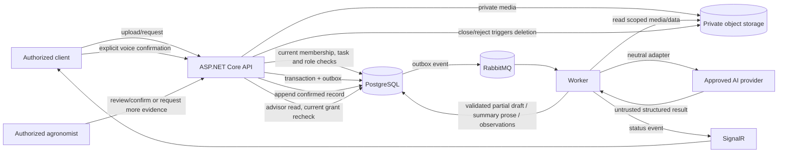

# Phase 4: Applied Farm Intelligence - Research

**Researched:** 2026-11-11  
**Domain:** ASP.NET Core 10, asynchronous AI workflows, farm-scoped reporting, private media lifecycle  
**Confidence:** MEDIUM

<user_constraints>
## User Constraints (from CONTEXT.md)

### Locked Decisions
- **D-01:** Support Dominican Spanish and Haitian Creole in the first voice-draft release.
- **D-02:** Accept recordings up to five minutes. When transcription is uncertain, create a partial editable draft and mark uncertain or missing fields for correction rather than silently filling them.
- **D-03:** Workers may create voice drafts only for tasks assigned to them; retain existing task and farm authorization checks.
- **D-04:** A draft never creates a logbook record until the authorized user explicitly confirms it. Delete audio at confirmation or seven days after processing if unreviewed, as required by REQ-rf-g-39.
- **D-05:** Define a week as Monday through Sunday using the farm's configured time zone. Generate a summary only when requested by an owner/administrator, not as a scheduled automatic report.
- **D-06:** A summary covers the whole farm and can be filtered to a crop cycle. Include confirmed records, pending tasks, and missing data. Totals are calculated deterministically from structured records and remain traceable to their sources; AI may only draft explanatory prose.
- **D-07:** Only the farm owner or administrator may review and share a summary. Sharing requires an active advisor grant whose scope permits the data. Advisors can see the summary and listed source records only when those sources are included in their current grant.
- **D-08:** Before agronomist review, AI may describe only visible signs and request additional photos; it must not give a diagnosis or treatment.
- **D-09:** Only a verified agronomist explicitly assigned or authorized for the farm may confirm diagnosis or treatment. If evidence is insufficient, the agronomist requests more photos/data and the report remains pending.
- **D-10:** Delete report photos when the review is closed or rejected, while retaining the report itself.
- **D-11:** Keep voice processing behind a provider-neutral contract. Validate language support and choose the transcription provider before enabling production, especially for Haitian Creole; Gemini's current language documentation did not verify Creole support.

### Prior decisions that remain binding
- AI outputs remain drafts and cannot confirm or mutate business records.
- Keep AI integrations provider-neutral. Gemini remains the current adapter for existing proposal workflows; Phase 4's voice provider must be validated and selected before enabling production.
- Agronomic parameters and numeric rules require validated sources. Do not invent crop facts, quantitative recommendations, or safe-use values.
- Check farm membership in PostgreSQL for every farm-scoped request. Advisor access remains read-only, scoped, revocable, and checked on every request.
- PostgreSQL remains authoritative; keep the existing API/Worker, RabbitMQ outbox, and SignalR job-status patterns.

### the agent's Discretion
- Select implementation details for language identification and transcription, structured output validation, retry/retention jobs, and AI evaluation, provided the decisions above and the provider-neutral boundary are honored.
- Determine the smallest privacy-preserving context needed by each AI operation; never send another farm's data or unnecessary personal identifiers.

### Deferred Ideas (OUT OF SCOPE)
None — discussion stayed within Phase 4 scope.
</user_constraints>

<phase_requirements>
## Phase Requirements

| ID | Description | Research Support |
|----|-------------|------------------|
| REQ-rf-g-39 | Transcribir voz del productor/trabajador y crear borrador editable de actividad, fecha, parcela, cultivo, cantidad y unidad; señalar campos faltantes. | Provider-neutral asynchronous pipeline, draft state, explicit confirmation, assignment/farm checks, private audio lifecycle and cleanup job. |
| REQ-rf-g-40 | Redactar resumen semanal desde registros confirmados, tareas pendientes y datos faltantes; totales se calculan con datos estructurados y permiten consultar fuentes. | Farm-local week projection, existing report calculation pattern, bounded source-grounded prose generation, current grant revalidation for summary and sources. |
| REQ-rf-g-43 | En fase futura, preparar reporte de síntomas por foto; agrónomo confirma diagnóstico y tratamiento. | Private image job, observation-only model contract, pending review state, explicit agronomist authorization and media deletion lifecycle. |
</phase_requirements>

## Summary

Build the three capabilities as farm-scoped persisted workflows on the existing API, PostgreSQL, RabbitMQ outbox, Worker, private Supabase storage, and SignalR status pattern. Keep the model behind application-owned ports. For speech, the provider selection and language-quality validation gate is a production prerequisite; until it passes, do not claim Haitian Creole capability or activate voice processing for that language. Existing Gemini proposal integration does not imply it is the selected speech provider. ASP.NET Core documents hosted/background services and scoped-service resolution for durable asynchronous processing; the repository already uses a Worker/outbox approach, so extend that pattern rather than creating a parallel queue mechanism. [CITED: https://learn.microsoft.com/en-us/aspnet/core/fundamentals/host/hosted-services?view=aspnetcore-10.0]

Treat AI output as untrusted and non-authoritative. Transcription produces a partial editable draft, summary prose is constrained by a deterministic source projection, and image analysis produces visible-sign observations only. Confirmation and authorization remain ordinary backend domain/API decisions. Keep each provider request minimal and single-farm scoped, validate structured output after parsing, and persist job state/idempotency data before dispatch. [CITED: https://ai.google.dev/gemini-api/docs/structured-output] [ASSUMED]

**Primary recommendation:** Extend the existing application ports and outbox/Worker flows with neutral speech and image-description contracts; implement deterministic summary projections and explicit review/retention state machines; block production speech activation until bilingual, field-recording evaluation and provider approval pass.

## Architectural Responsibility Map

| Capability | Primary Tier | Secondary Tier | Rationale |
|------------|-------------|----------------|-----------|
| Voice draft API, assignment and farm authorization, explicit confirmation | API / Backend | Database / Storage | API applies current permissions and owns the draft-to-logbook transition; PostgreSQL remains authoritative. |
| Audio transcription and draft extraction | API / Backend | Worker / External provider | API stages and queues; Worker performs provider work asynchronously and persists partial output. |
| Audio retention and cleanup | Database / Storage | Worker | Storage contains private audio; persisted timestamps/state drive retryable deletion. |
| Weekly source projection and deterministic totals | API / Backend | Database / Storage | Queries and unit-safe arithmetic use structured farm data; AI only adds bounded explanatory prose. |
| Summary sharing with advisor | API / Backend | Database / Storage | Every read/share checks current membership and grant scope, including each source record. |
| Symptom report upload and agronomist review | API / Backend | Database / Storage | API enforces farm/media permissions and review authority; storage holds private source images. |
| Image observation generation | Worker / External provider | API / Backend | Worker uses the neutral vision adapter; backend keeps diagnosis/treatment unavailable until authorized human review. |

## Standard Stack

### Core

| Library / component | Version | Purpose | Why Standard |
|--------------------|---------|---------|--------------|
| Existing AgroPlan API + Worker | .NET 10 (repo target; runtime observed as .NET SDK 10.0.404 in parent environment) | HTTP authorization, background provider work, notifications | Existing solution already separates API and Worker; avoid a second processing architecture. [VERIFIED: .planning/phases/04-applied-farm-intelligence/04-CONTEXT.md, code_context; [CITED: Microsoft hosted services](https://learn.microsoft.com/en-us/aspnet/core/fundamentals/host/hosted-services?view=aspnetcore-10.0)] |
| PostgreSQL + existing EF Core migrations | Existing solution version | Durable workflow status, drafts, summaries, reports, source links and lifecycle timestamps | PostgreSQL is the chosen source of truth in phase context; use repository migration/testing patterns. [VERIFIED: .planning/phases/04-applied-farm-intelligence/04-CONTEXT.md, prior decisions] |
| Existing RabbitMQ outbox + Worker consumers | Existing solution | Reliable asynchronous AI and cleanup work | Reuses persisted state + outbox and idempotent consumer pattern. [VERIFIED: .planning/phases/04-applied-farm-intelligence/04-CONTEXT.md, code_context] |
| Existing `IFileStorage` / private Supabase storage | Existing solution | Private upload, download for Worker, and deletion of source media | Reuse current attachment/finalization contracts; keep provider media outside public URLs. [VERIFIED: .planning/phases/04-applied-farm-intelligence/04-CONTEXT.md, code_context] |
| Existing xUnit v3 + Testcontainers + Scalar/OpenAPI | Existing solution | Unit, PostgreSQL integration, API contract tests | Explicitly present in phase code context; no new test/documentation package is required. [VERIFIED: .planning/phases/04-applied-farm-intelligence/04-CONTEXT.md, code_context] |

### Supporting

| Component | Purpose | When to Use |
|-----------|---------|-------------|
| `IAiProposalProvider` pattern generalized to task-specific neutral ports | Isolate application contract from vendor SDKs and provider DTOs | New speech, summary-prose, and image-observation operations. Keep each port narrowly scoped; do not pass domain repositories or mutation tools to the model. [VERIFIED: .planning/phases/04-applied-farm-intelligence/04-CONTEXT.md, code_context] |
| Versioned JSON schema + `System.Text.Json` and domain validation | Parse and validate extracted draft/observation output | All model structured responses; schema validity is not business validation. [CITED: https://ai.google.dev/gemini-api/docs/structured-output] |
| Existing report reader / source IDs | Deterministic totals and traceability | Reuse for weekly cost/production projections where dimensions and units match; preserve incompatible-unit/missing-conversion disclosure. [VERIFIED: .planning/phases/04-applied-farm-intelligence/04-CONTEXT.md, code_context] |
| Existing SignalR job status | Expose processing, partial, unavailable and completion progress | Reuse existing notification route; database state remains authoritative. [VERIFIED: .planning/phases/04-applied-farm-intelligence/04-CONTEXT.md, code_context] |

### Alternatives Considered

| Instead of | Could Use | Tradeoff |
|------------|-----------|----------|
| Existing persisted outbox/Worker jobs | In-memory hosted queue or direct provider calls in HTTP requests | In-memory work can be lost on restart; synchronous provider calls increase request latency and make retry/deletion harder. Microsoft documents hosted services but a process-local queue alone is not durable. [CITED: https://learn.microsoft.com/en-us/aspnet/core/fundamentals/host/hosted-services?view=aspnetcore-10.0] |
| Deterministic source projection for numeric summaries | Let the model calculate totals from raw logs | Model arithmetic and omitted records are not authoritative; source-backed calculations are testable and reproducible. [ASSUMED] |
| Provider-neutral speech contract and gate | Bind API/application types directly to Gemini SDK | Couples user-visible behavior to vendor DTOs and would make provider changes invasive; Creole coverage is not yet approved. [VERIFIED: .planning/phases/04-applied-farm-intelligence/04-CONTEXT.md, D-11] |

**Installation:** No additional package is recommended for this phase. Reuse current SDK and test stack. If provider adapter dependencies change, run the repository's package-legitimacy workflow and verify package legitimacy before adding them.

## Package Legitimacy Audit

No new external package is recommended; this phase should use the existing API, Worker, storage, EF Core, messaging, xUnit v3 and OpenAPI/Scalar dependencies. No package legitimacy gate is needed unless planning introduces a new SDK.

## Architecture Patterns

### System Architecture Diagram



### Recommended Project Structure

Follow existing clean-architecture project boundaries; exact filenames and namespaces are for the planner to align with neighboring features.

```text
src/
├── AgroPlan.Application/Abstractions/  # Neutral, narrow provider contracts
├── AgroPlan.Application/               # Use cases, authorization-aware projections, validation
├── AgroPlan.Domain/                    # Draft/report/review lifecycle rules
├── AgroPlan.Infrastructure/            # EF mappings, migrations, private storage and cleanup
├── AgroPlan.Api/                       # Upload, status, review, confirmation, summary/share endpoints
└── AgroPlan.Worker/                    # Idempotent AI and media-deletion consumers
tests/
├── AgroPlan.Application.Tests/         # Deterministic rules and provider-contract tests
└── AgroPlan.IntegrationTests/          # PostgreSQL, authorization and storage/job workflows
```

### Pattern 1: Persisted asynchronous, idempotent AI job

**What:** Authorize and persist job/media metadata and an outbox event in one database transaction; return a job identifier; Worker loads only the scoped input, invokes an adapter, validates output, persists result and emits status. Provider or storage retries must not create duplicate drafts or records. [VERIFIED: .planning/phases/04-applied-farm-intelligence/04-CONTEXT.md, code_context] [CITED: https://learn.microsoft.com/en-us/aspnet/core/fundamentals/host/hosted-services?view=aspnetcore-10.0]

**When to use:** Voice transcription/extraction and image observations; use the same durable pattern for deletion retries.

```csharp
// Architectural sketch: application code sees a neutral port, not vendor SDK types.
public interface ISpeechTranscriptionProvider
{
    Task<SpeechTranscriptionResult> TranscribeAsync(
        SpeechTranscriptionRequest request,
        CancellationToken cancellationToken);
}

// Worker flow: load authorized job -> invoke provider -> validate -> persist.
// A provider response is untrusted input and cannot append a logbook entry.
```

**Important:** This is an architectural sketch, not a claim that these exact types already exist. Provider activation should be configuration-gated and default off until the language/provider validation gate is recorded as passed. [ASSUMED]

### Pattern 2: Deterministic summary projection, bounded prose

Compute the local-week boundaries from the farm's configured time zone, query confirmed records and pending tasks for that interval, optionally filter to a crop cycle, and calculate totals with existing unit/currency rules. Pass a bounded projection, source IDs, and missing-data markers to the prose adapter. Validate that every cited source belongs to the projection. Never derive totals or authorization decisions from generated prose. [VERIFIED: .planning/phases/04-applied-farm-intelligence/04-CONTEXT.md, D-05–D-07; code_context]

```text
request -> authenticate current farm membership -> resolve farm time zone
        -> [Monday 00:00 local, following Monday 00:00 local)
        -> farm/cycle scoped structured projection + deterministic totals
        -> bounded summary adapter -> persist draft with exact source IDs
        -> owner/admin reviews -> re-check advisor grant on share and read
```

Use half-open time intervals and convert boundaries to instants once; the locked product rule remains Monday through Sunday in the farm's configured timezone. Do not compute “last seven days” or assume the server time zone. The timezone identifier mapping and invalid-zone handling are implementation details to confirm against existing farm configuration, not open product decisions. [VERIFIED: .planning/phases/04-applied-farm-intelligence/04-CONTEXT.md, D-05] [ASSUMED]

### Pattern 3: Observation-only symptom report and human review

Store private photos with report/job metadata, invoke a provider-neutral image-observation port with only crop/parcel/stage context needed for visual description, and persist observation plus explicit evidence gaps. The pre-review contract must not expose diagnosis/treatment fields. Agronomist confirmation requires verified account plus farm-specific assignment/authorization checked at request time. “Need more evidence” retains the pending report. Closing/rejecting transitions report state and schedules source-photo deletion with retryable status while retaining the report. [VERIFIED: .planning/phases/04-applied-farm-intelligence/04-CONTEXT.md, D-08–D-10]

### Anti-Patterns to Avoid

- Putting Gemini/provider SDK types in API or domain contracts.
- Calling providers inside HTTP requests or relying on volatile in-memory job queues.
- Allowing model output to append a logbook entry, determine permission, calculate totals, or confirm diagnosis/treatment.
- Treating a generated summary as a full record of activity when inputs are missing or projection limits are reached.
- Generating a local-week report from server-local time or filtering by UTC date before resolving farm-local boundaries.
- Sharing previously approved summary content without rechecking current grant scope and each listed source.
- Public media URLs, provider URIs, transcripts, raw images, credentials, or signed URLs in application logs.
- Claiming Haitian Creole support from a multilingual marketing statement without production-path locale confirmation and local recording evaluation.

## Don't Hand-Roll

| Problem | Don't Build | Use Instead | Why |
|---------|-------------|-------------|-----|
| Durable asynchronous work | A custom volatile in-memory queue | Existing RabbitMQ outbox/Worker/idempotency pattern | Persists intent across process restarts and matches repository architecture. |
| AI integration isolation | Vendor-specific application DTOs spread across features | Narrow neutral application ports plus provider adapters | Keeps vendor replacement local and lets tests fake model responses. |
| Private upload and deletion | New public file endpoint or ad-hoc storage client | Existing `IFileStorage` and private Supabase conventions | Avoids conflicting access controls and storage lifecycles. |
| Unit/currency totals | Model arithmetic or a second report calculator | Existing report reader/projection, with explicit unsupported conversions | Reuses established deterministic source references and unit handling. |
| Permission checks | Cache role/grant in a long-lived job or trust old authorization | Existing per-request PostgreSQL membership and current grant-scope checks | Revocation should take effect immediately for API reads/actions. |
| Model schema validation | Trust JSON mode/schema alone | Deserialize plus application/domain validation and ownership checks | Structured output can still be incomplete, semantically invalid, or cross-scope. |

**Key insight:** The model is a replaceable transformation step; the authoritative workflow is the persisted state machine, deterministic projection, authorization, and explicit human action around it.

## Common Pitfalls

### Pitfall 1: Provider selected on nominal language list only
**What goes wrong:** A voice feature is enabled although Haitian Creole, mixed Dominican Spanish/Kreyòl, or noisy agricultural audio performs poorly.  
**Why it happens:** Generic multilingual support does not establish operation-specific or dialect-specific quality. Gemini language support must be confirmed against the currently selected transcription API/model; the user has made that a gate.  
**How to avoid:** Keep speech contract neutral and feature flag off; test consented representative local field recordings with bilingual human reference transcripts, including quantities, units, negation, names of tasks/crops, noise and code-switching. Record threshold and provider selection as a production release gate.  
**Warning signs:** Quietly normalizing uncertain numbers, translated Kreyòl terms, missing `language` result metadata, or no human evaluation set. [CITED: https://ai.google.dev/gemini-api/docs/transcribe] [ASSUMED]

### Pitfall 2: Media deletion and provider retention drift apart
**What goes wrong:** AgroPlan deletes an object while an uploaded provider copy remains, or an object deletion failure is hidden while the report appears closed.  
**Why it happens:** Storage and AI-provider media have separate IDs, lifetimes and deletion APIs. Phase AI design notes Gemini Files temporary retention as separate from app retention.  
**How to avoid:** Track app object ID and provider upload ID only as needed; delete audio on confirmation or seven days after processing if unreviewed, and delete report photos on close/rejection while retaining the report; retry failures and avoid media bytes in logs. These are the locked application-retention rules.  
**Warning signs:** No deletion outbox, no idempotent delete consumer, or no test that report remains after source media is gone. [VERIFIED: .planning/phases/04-applied-farm-intelligence/04-AI-SPEC.md, section 3; see user retention decision]

### Pitfall 3: Authorization checked only when work was queued
**What goes wrong:** A worker, advisor, or agronomist retains access after assignment or grant revocation.  
**Why it happens:** A long-running job or previously generated summary is treated as a durable permission grant.  
**How to avoid:** Revalidate current farm membership/assignment when a worker submits a draft, owner confirms, advisor reads/shares summary, and agronomist reviews. Provider job may use only the authorized snapshot of data necessary for the request; return or discard stale results according to a documented policy.  
**Warning signs:** Authorization decisions copied into model payloads, no farm ID predicates in source queries, or share links bypassing current grant checks. [VERIFIED: .planning/phases/04-applied-farm-intelligence/04-CONTEXT.md, prior decisions]

### Pitfall 4: Weekly report totals cross time zones or incomparable dimensions
**What goes wrong:** Events around midnight or a daylight-saving transition are assigned to the wrong farm week; unlike units/currencies are summed.  
**Why it happens:** UTC/server date is used as the calendar date, or existing conversion gaps are ignored.  
**How to avoid:** Resolve farm-local Monday start and next-Monday exclusive boundary, convert to UTC instants for query, and use existing deterministic unit/currency rules. Test events immediately before/at both boundaries and disclose incompatible measures. [VERIFIED: .planning/phases/04-applied-farm-intelligence/04-CONTEXT.md, D-05–D-06; code_context]

### Pitfall 5: Photo report leaks diagnosis before review
**What goes wrong:** A UI/API field exposes model-generated “likely disease” or treatment as approved advice.  
**Why it happens:** One generic AI response schema mixes observation and adjudication.  
**How to avoid:** Separate pre-review observation DTO from agronomist-authored diagnosis/treatment; keep all symptom inference pending and provide additional-evidence state. No agronomic values or recommendations are to be invented. [VERIFIED: .planning/phases/04-applied-farm-intelligence/04-CONTEXT.md, D-08–D-10]

## Code Examples

### Durable worker boundary

Microsoft's hosted-service guidance says a hosted service is singleton and should create a scope to resolve scoped processing services; for this repo, the existing dedicated Worker/outbox should remain the queue owner. [CITED: https://learn.microsoft.com/en-us/aspnet/core/fundamentals/host/hosted-services?view=aspnetcore-10.0]

```csharp
// Sketch only; the repository's existing RabbitMQ consumer is the dispatcher.
public interface IImageObservationProvider
{
    Task<ImageObservationResult> DescribeVisibleSignsAsync(
        ImageObservationRequest request,
        CancellationToken cancellationToken);
}
```

### Local week boundary

```text
localStart = Monday 00:00 in the farm's configured time zone
localEnd   = next Monday 00:00 in the same time zone (exclusive)
query      = eventInstant >= localStartInstant && eventInstant < localEndInstant
```

Treat this as implementation guidance; confirm timezone storage format and invalid-zone policy against existing farm settings during planning. [ASSUMED]

## State of the Art

| Old Approach | Current Approach | When Changed | Impact |
|--------------|------------------|--------------|--------|
| Request-thread model call with response immediately treated as result | Persisted job, validated result, explicit review/confirmation | Phase 4 architecture decision | Supports retries, cancellation, traceability and user control. [VERIFIED: 04-CONTEXT.md, code_context] |
| Model-generated summary numbers | Structured deterministic totals with model-limited prose | Phase 4 D-06 | Numeric claims remain reproducible and source-linked. [VERIFIED: 04-CONTEXT.md, D-06] |
| Generic symptom diagnosis from a photo | Visible-sign description and evidence request until authorized agronomist review | Phase 4 D-08/D-09 | Prevents model output from being treated as approved agronomy. [VERIFIED: 04-CONTEXT.md, D-08–D-09] |

**Deprecated/outdated:** No repo-specific API or SDK deprecation was established by this research. Keep provider API lifecycle inside adapters and verify the selected vendor's supported endpoint at the provider gate. [ASSUMED]

## Assumptions Log

| # | Claim | Section | Risk if Wrong |
|---|-------|---------|---------------|
| A1 | Existing storage supports a server-side deletion operation suitable for retries. | Standard Stack / pitfalls | Could require a storage contract extension or provider-specific implementation. |
| A2 | The existing farm configuration can supply the timezone, or an implementation change can persist it. | Summary pattern | The locked Monday–Sunday farm-local rule requires a trustworthy configured timezone. |
| A3 | Current provider-neutral pattern can be extended into separate speech and image-observation contracts without changing existing proposal contracts. | Stack | Could require a shared abstraction refactor. |
| A4 | Production speech can be gated by configuration/feature flag while tests use provider fakes. | Pattern 1 | If no flag exists, a safe rollout mechanism must be designed. |
| A5 | A project-approved threshold for Creole and Dominican field audio quality has not yet been defined. | Pitfall 1 | No objective activation decision can be made without an acceptance threshold and labeled data. |
| A6 | The exact time-zone identifier mapping, invalid-zone handling, summary freshness/versioning, byte-size media caps, and image count/format limits are implementation details not specified in the context. The five-minute audio duration and media deletion conditions are already locked. | Patterns | Affects API validation, migrations, projection consistency and storage cost; does not change the locked product rules. |
| A7 | Provider data processing, deployment region, paid-service terms, and lawful basis/notice for worker audio and farm photos require project-owner/privacy review before production media is sent. | Pitfalls | Incorrect vendor/consent posture can expose sensitive personal or farm data. |

## Open Questions

Only question 1 is a production activation gate. Questions 2–4 are implementation details for planning and do not reopen the locked five-minute voice duration, Monday–Sunday farm-local calendar, or photo/audio deletion conditions.

1. **Which speech provider and production configuration pass the language gate?**
   - What we know: User selected a neutral contract and explicitly requires validation before activation; the phase context requires Dominican Spanish and Haitian Creole.
   - What's unclear: Supported language/locale for the exact transcription operation, dialect/code-switch quality, deployment region, data use, price and operational SLA.
   - Recommendation: Keep the provider unselected in code configuration until provider comparison and bilingual, human-labeled field-audio evaluation are approved. This is the principal production activation gate.
2. **Which timezone identifier mapping and invalid-zone behavior fit the existing farm configuration? (Implementation detail; Monday–Sunday in farm-local time is locked.)**
   - What we know: Weekly calendar is farm-local Monday–Sunday.
   - What's unclear: IANA vs Windows IDs and how the existing model handles DST/invalid IDs.
   - Recommendation: Inspect farm configuration and standardize an explicit mapping at planning; test DST boundaries and invalid/missing values. This does not reopen the calendar-week decision.
3. **What is the lifecycle policy when authorization changes during asynchronous processing? (Implementation detail; per-request authorization is locked.)**
   - What we know: API checks membership for every request, and advisors/agronomists need current scoped authority.
   - What's unclear: Whether an already queued result is discarded or retained privately after worker assignment/grant revocation.
   - Recommendation: Re-check before any user-visible read/write; define queued-job cancellation/discard behavior and avoid provider requests if authority is no longer valid.
4. **What byte/image-count and summary projection limits should complement the locked five-minute audio duration cap? (Implementation detail.)**
   - What we know: Voice recordings are capped at five minutes; audio and symptom-photo deletion conditions are already fixed in D-04 and D-10; media remains private.
   - What's unclear: Byte, image-count, dimension, request-rate and summary source caps.
   - Recommendation: Specify server-side byte/count limits and partial/unavailable behavior before implementation; do not silently truncate source evidence. This is not an open decision about audio duration or deletion timing.

## Environment Availability

| Dependency | Required By | Available | Version | Fallback |
|------------|------------|-----------|---------|----------|
| .NET SDK | API, Worker and xUnit v3 implementation | ✓ | 10.0.404 observed in parent environment | — |
| Docker | PostgreSQL/RabbitMQ Testcontainers integration tests | ✓ | 28.4.0 observed in parent environment | None for equivalent real-provider integration coverage; developer must enable Docker. |
| PostgreSQL | Migration and integration tests | ✓ via Testcontainers | Container image version follows existing test setup | — |
| RabbitMQ | Outbox/consumer integration tests | ✓ via Testcontainers | Container image version follows existing test setup | Unit tests with fake consumers only as a reduced fallback. |
| Selected speech provider account/credentials | Provider contract/evaluation and production speech activation | ✗ / not confirmed | — | Neutral adapter fake for development/tests; production speech remains disabled. |
| Provider language evaluation corpus | Haitian Creole / Dominican Spanish activation gate | ✗ / not confirmed | — | No production fallback: selecting provider requires validated recordings and human references. |

**Missing dependencies with no fallback:** Approved production speech provider and bilingual field-audio evaluation corpus block voice activation for real users; implementation can still proceed against the neutral contract and fake adapter.

**Missing dependencies with fallback:** Provider credentials can be absent in local development while unit/integration tests use fakes.

## Validation Architecture

### Test Framework

| Property | Value |
|----------|-------|
| Framework | xUnit v3 (existing repository test framework) |
| Config file | Existing solution test projects; inspect nearest Phase 3 test project before adding files |
| Quick run command | `dotnet test <focused-test-project> --no-restore` |
| Full suite command | `dotnet test AgroPlan.sln` |

The exact test project paths/solution file spelling must be copied from the repository at planning time. Commands above are templates, not verified shell invocations. [ASSUMED]

### Phase Requirements → Test Map

| Req ID | Behavior | Test Type | Automated Command | File Exists? |
|--------|----------|-----------|-------------------|-------------|
| REQ-rf-g-39 | Five-minute limit, assigned-task-only checks, partial/missing fields, no logbook append before explicit confirmation, idempotent confirmation, delete on confirmation and after seven-day deadline | unit + API/PostgreSQL/Worker integration | `dotnet test <focused-test-project> --filter FullyQualifiedName~Voice` | ❌ Add in phase |
| REQ-rf-g-40 | Farm-local Monday–Sunday bounds; confirmed records + pending tasks + missing markers; deterministic totals/source IDs; cycle filter; advisor scope rechecked on share and every source read | unit + API/PostgreSQL integration | `dotnet test <focused-test-project> --filter FullyQualifiedName~WeeklySummary` | ❌ Add in phase |
| REQ-rf-g-43 | Only visible signs before approval; insufficient evidence remains pending; only verified assigned agronomist can confirm; source photos deleted at close/reject while report remains | unit + API/PostgreSQL/storage integration | `dotnet test <focused-test-project> --filter FullyQualifiedName~SymptomReport` | ❌ Add in phase |

### Sampling Rate

- **Per task commit:** focused xUnit unit tests plus affected focused integration test when the task changes persistence or authorization.
- **Per wave merge:** all Phase 4 tests, including PostgreSQL/Testcontainers and RabbitMQ outbox tests.
- **Phase gate:** full suite green before verification; provider-specific activation stays gated on bilingual evaluation independent of code tests.

### Wave 0 Gaps

- [ ] Add tests for provider-neutral speech/vision contract fakes and structured response validation.
- [ ] Add PostgreSQL integration coverage for persisted states, outbox/idempotency, current membership/grant checks and retention timestamps.
- [ ] Add storage deletion retry tests for confirmed voice drafts and closed/rejected symptom reports.
- [ ] Create a reviewed, consented Spanish/Kreyòl evaluation set before enabling the real speech provider; this is a production gate, not a substitute for xUnit.

## Security Domain

### Applicable ASVS Categories

| ASVS Category | Applies | Standard Control |
|---------------|---------|-----------------|
| V2 Authentication | Yes | Existing authenticated identity and verified agronomist status; do not trust provider or client claims. |
| V3 Session Management | Yes | Existing API session/JWT handling; re-evaluate farm membership on each farm-scoped request. |
| V4 Access Control | Yes | Server-side membership, worker-task assignment, owner/admin rights, agronomist assignment and advisor grant scope. |
| V5 Input Validation | Yes | Enforce duration, media type/size/count, identifiers and structured result validation server-side. |
| V6 Cryptography | Yes | Use existing TLS, storage/provider secrets management and signed private access; never hand-roll crypto. |
| V8 Data Protection | Yes | Minimize provider payloads and retain/delete media per locked lifecycle; no raw media/transcripts in logs. |
| V10 Malicious Code | Yes | Treat transcript, image OCR, notes and provider responses as untrusted prompt/data content; no model tools or executable output. |
| V13 API and Web Service | Yes | Farm-scope every query, authorize every read/share/action, bound request resources and return no cross-farm existence leaks. |

### Known Threat Patterns for .NET API + AI Worker

| Pattern | STRIDE | Standard Mitigation |
|---------|--------|---------------------|
| Cross-farm IDOR in media, job, summary or source-record endpoint | Elevation of privilege / Information disclosure | Include farm scope in persistence predicates and re-check current authorization for every endpoint. |
| Prompt injection inside transcript, photo text or farm notes | Tampering | Treat content as untrusted data; no tools, permissions, or mutations exposed to model; validate response and source IDs. |
| Duplicate outbox delivery creates duplicate draft/logbook record | Repudiation / Tampering | Idempotency key and unique job/draft confirmation guard; append only after authorized explicit confirmation. |
| Provider/private-object retention mismatch | Information disclosure | Track provider and object-storage IDs for deletion; retry; minimize external uploads; exclude from logs. |
| Summary shared after advisor scope revoked | Information disclosure | Re-check active grant on each view/share and each listed source read. |
| Model returns diagnosis or treatment in a supposedly observation response | Tampering / Elevation of trust | Separate schema and domain type; reject forbidden fields; do not present diagnosis/treatment before authorized agronomist review. |

## Sources

### Primary (HIGH confidence)

- Repository `.planning/phases/04-applied-farm-intelligence/04-CONTEXT.md` — locked user decisions, code context, data retention and boundaries (opened this session).
- Repository `.planning/phases/04-applied-farm-intelligence/04-AI-SPEC.md` — provider-neutral contracts, async pipeline, validation, privacy and production gate (opened this session).
- Repository `.planning/REQUIREMENTS.md` — exact Phase 4 requirement text (opened this session).
- [Microsoft Learn: Background tasks with hosted services in ASP.NET Core](https://learn.microsoft.com/en-us/aspnet/core/fundamentals/host/hosted-services?view=aspnetcore-10.0) — durable host lifecycle/scoped background service guidance. [CITED: Microsoft Learn]
- [Azure Speech language support](https://learn.microsoft.com/en-us/azure/ai-services/speech-service/language-support) — operation-specific locale matrix; confirms language capability must be checked per speech feature. [CITED: Microsoft Learn]
- [Gemini audio transcription](https://ai.google.dev/gemini-api/docs/transcribe) and [structured output](https://ai.google.dev/gemini-api/docs/structured-output) — provider capabilities and constrained response considerations; pages redirected during this research and could not be opened directly, so defer exact compatibility claims to provider validation. [CITED: Google AI docs]

### Secondary (MEDIUM confidence)

- Phase AI-SPEC references to Google terms, API pricing and temporary uploaded-file retention — use only as planning signals; recheck exact model, billing and account retention terms before deployment.

### Tertiary (LOW confidence)

- No external package or provider was selected from tertiary web-only evidence.

## Metadata

**Confidence breakdown:**
- Standard stack: HIGH — based on opened phase context and AI-SPEC plus Microsoft official worker documentation.
- Architecture: MEDIUM — strong fit to repository's described patterns; implementation details and migration/job state shape remain for planning.
- Pitfalls: MEDIUM — privacy, authorization, source-grounding and human review are locked; numeric thresholds and provider-specific behavior remain open.

**Research date:** 2026-11-11  
**Valid until:** 2026-12-11 for stable architecture; provider capabilities, prices, terms and locale support must be rechecked before production activation.
